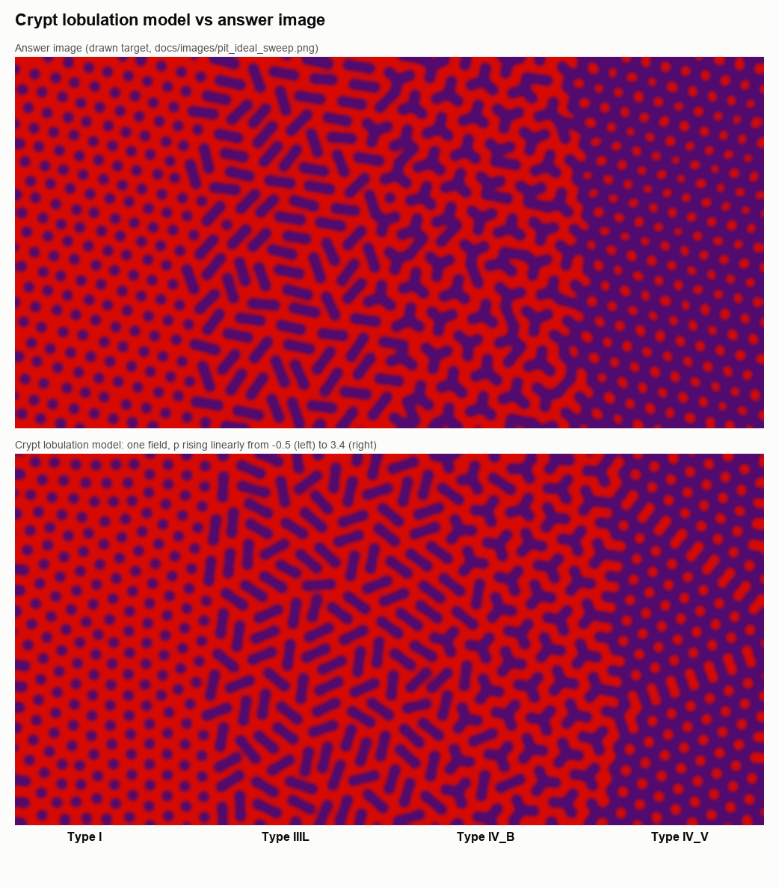
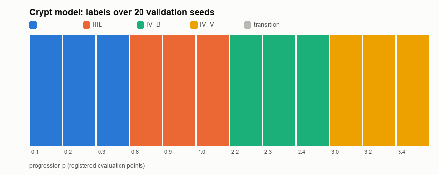
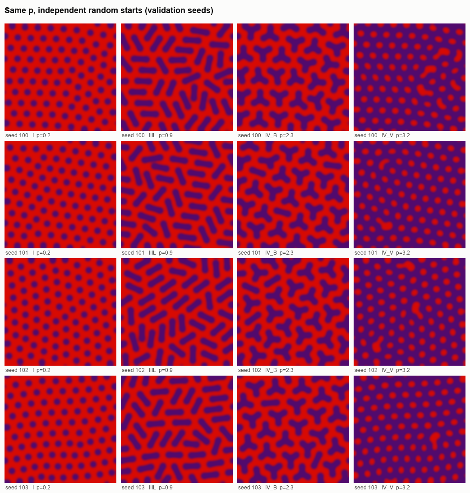

# 陰窩分葉モデル（crypt lobulation model）: 答案見本の I → IIIL → IV_B → IV_V

2026-10-10。ゴール: [`pit_pattern_goal.md`](../pit_pattern_goal.md)、検証規約: [独立初期化 protocol](../protocols/pit_independent_initialization_protocol.md)。

**結論**: 固定した係数・1 本の進行度 \(p\)・毎回独立なランダム初期条件から、答案見本の 4 帯が再現した。事前登録した 12 点すべてで、検証 seed 20 個中 **20 個**が目標の帯になった（95% Wilson 下限 0.84）。帯の純度（IIIL は全点が短管、IV_B は全点が Y）、単位の有限性、幅の上限（median ≤ 1.11 w₀、p90 ≤ 1.29 w₀）も満たす。ただし「pit が何個の陰窩に属せるか（価数）が \(p\) とともに増える」ことはモデルの**仮定**であり、自発的に導いたものではない（§4）。



*上: 答案見本（描画）。下: このモデルの 1 枚の場で、\(p\) を左 −0.5 から右 3.4 へ直線的に変えたもの。色・ぼかしは同じ描画規則。*

## 1. モデル

**生物学的な読み**: 表面から見える pit は陰窩開口の「葉」で、陰窩の niche がほぼ六方格子に並ぶ位置にある。進行とともに 1 つの陰窩が束ねる葉が増える。2 葉が内腔でつながると短管（IIIL）、3 葉が共通の内腔でつながると Y（IV_B）、陰窩どうしが内腔で融合すると溝が網になり粘膜が島になる（IV_V ＝ I の明暗反転）。

1. **葉の位置**: N 個の粒子を周期領域の一様乱数位置から置き、軟らかい反発で緩和させる。平均間隔以外は与えず、ほぼ六方格子（I）に自己組織する（隣接距離の変動 ≈ 3%）。
2. **候補の単位**: 隣接 2 葉を結ぶ短管（辺）と、互いに隣接する 3 葉を三角形の中心で結ぶ Y（三角形）。
3. **エネルギー**（係数はすべて \(p\) だけの固定した区分線形関数）

\[
E = -\mu_e(p)\,N_\text{tube} - \mu_t(p)\,N_\text{Y}
 + \sum_\text{葉}\begin{cases} c_0(p) & \text{どの単位にも属さない}\\ K(p)\,(v-1) & v \ge 1 \text{ 個の単位に属する}\end{cases}
 + J\,N_\text{衝突}
\]

| 記号 | 意味 | \(p\) 依存 |
|---|---|---|
| \(\mu_e\) | 2 葉の陰窩（短管）の利得 | \(2(p-0.5) - 4\max(0, p-1.6)\)（IIIL で最大、その後 Y に置き換わる） |
| \(\mu_t\) | 3 葉の陰窩（Y）の利得 | \(3.4(p-1.05)\) |
| \(K\) | 1 つの葉が複数の陰窩に属する障壁（陰窩融合の障壁） | \(\max(0, 6(2.9-p))\) |
| \(c_0\) | 単独の葉のコスト | \(\max(0, 1.5(p-0.5))\) |
| \(J\) | 粘膜を潰す配置（辺を共有する 2 つの Y、同じ辺の短管と Y）の罰 | 50（固定） |

4. **ダイナミクス**: ランダムな初期状態から、メトロポリス法の局所更新（単独の開閉、同じ葉を使う単位との組み替え、衝突相手との入れ替え）でアニーリングする（500 sweep、初期温度は最大利得の大きさ）。どの葉が組むか、短管と Y の向き、IV_V の網の向きは局所的に決まる。
5. **描画**: 葉・短管・Y の腕を描いてガウスぼかしし、濃さをスライド 6 の赤→紫に写す（答案見本と同じ規則）。腕の太さは、ぼかし後の幅が単独の葉の開口径と一致するよう較正した。

周期領域は格子と整合する 9 × 10 セル（90 葉）。実装: [`src/pitpattern/models/simulate_pit_crypt.py`](../../src/pitpattern/models/simulate_pit_crypt.py)。

### 帯が現れる仕組み

- \(p<0.5\): 単位はどれも損 → 葉は単独（I）。
- \(0.5<p<1.3\): \(c_0>0\) で単独の葉が損、\(K\) が大きく価数は 1 まで、\(\mu_e > \mu_t/1.5\) → 全葉が 2 個ずつ組む（完全マッチング ＝ IIIL）。
- \(1.9<p<2.7\): \(\mu_t > 1.5\mu_e\)（同じ葉数を覆うのに Y は短管の 2/3 個で済む）→ 全葉が 3 個ずつ組む（IV_B）。
- \(p>2.7\): \(K \to 0\) で葉が複数の陰窩に属せる。辺を共有する Y は共存できないので、Y を最大限に詰めると片方の向きの三角形が全部 Y になり、紫は蜂の巣状の網、もう一方の向きの三角形の中心に赤い島が残る（IV_V）。

## 2. 検証

判定規則（探索 seed 1–3 で固定）: 単独の葉 ≥ 90% → I、短管だけに属する葉 ≥ 90% → IIIL、Y または短管に属する葉 ≥ 90% かつ Y ≥ 75% → IV_B、価数 3 の葉 ≥ 85% → IV_V、その他は transition。点は [`preregistration.json`](../../artifacts/pit_crypt/validation/preregistration.json) に書いてから検証 seed 100–119 を走らせた。判定はアニーリング後、さらに低温で 2000 sweep 保持した後の状態で行う。



| 帯 | \(p\) | 目標ラベル / 20 | 幅 median / w₀ | 幅 p90 / w₀（最大） | 三叉（中央値） |
|---|---|---|---:|---:|---:|
| I | 0.1 / 0.2 / 0.3 | 20 / 20 / 20 | — | 1.00 | 0 |
| IIIL | 0.8 / 0.9 / 1.0 | 20 / 20 / 20 | 1.00 | 1.06 | 0 |
| IV_B | 2.2 / 2.3 / 2.4 | 20 / 20 / 20 | 1.03 | 1.20 | 22–24 |
| IV_V | 3.0 / 3.2 / 3.4 | 20 / 20 / 20 | 1.11 | 1.29 | 148 |

w₀ = I の pit の開口径（面積等価径、14.0 px）。既存の骨格ベースの幅は、円板では骨格が刈り込まれて全画素の平均距離で代用されるため、開口径を約 1/3 過小評価する（13.2 px の点を 9.2 px と測る）。ゴールの基準は「I の pit 径と同じオーダー」なので開口径を使った。



*同じ \(p\)、独立な乱数初期化（検証 seed 100–103）。配置は毎回違うが形態は同じ。*

探索の全 \(p\) 走査（seed 1–3、0.2 刻み）では、I: \(p \le 0.4\)、IIIL: 0.6–1.2、移行（短管と Y の混在）: 1.4–1.8、IV_B: 2.0–2.6、IV_V: \(p \ge 2.8\)。3 seed で帯の境界は同じだった。

## 3. 限界

- **IV_V の向きの境界**: 網の向き（どちらの三角形を使うか）が違う領域の境界に、赤が 2 つつながった細長い島が並ぶ（1 視野に 1–3 個、横長の場では数本の筋）。自己組織した多結晶の格子では粒界と重なって残り、2000 sweep でも消えない。
- **保持中の組み替え**: 判定は保持後も全点で変わらないが、IV_B（特に \(p=2.4\)）ではエネルギーの等しい配置どうしの組み替えが保持中に最大 55 単位起きる。形態は保たれるが配置は凍結していない。
- **移行が急**: 独立な一様 \(p\) の計算では、I→IIIL（\(p≈0.5\)）と IV_B→IV_V（\(p≈2.7\)）がほぼ不連続に切り替わる。中間形態は空間勾配の場（上図）では境界に現れる。
- **領域**: 検証は格子と整合する周期領域（90 葉）。整合しない領域では格子欠陥が増え、IV_V の境界も増える見込み（未検証）。

## 4. 何が仮定で、何が自発的か

| 自発的（乱数初期化から局所ダイナミクスで決まる） | 仮定（モデルに入れたもの） |
|---|---|
| 葉の六方格子とその欠陥 | 葉の平均間隔 |
| どの葉どうしが組むか、短管・Y の向き | 単位の候補は「隣接 2 葉」と「互いに隣接する 3 葉」 |
| 帯の純度（全葉が組む）、単位が有限で止まること | 価数（葉が属せる陰窩の数）と、2 葉・3 葉の陰窩の利得が \(p\) とともに変わること |
| IV_V の網の向きと、その境界 | 粘膜を潰す配置の排他 |

価数が \(p\) で増える理由（陰窩分裂・分葉・融合の制御）はこのモデルの外にある。次の課題は、この価数の変化を、細胞・組織レベルの量（陰窩あたりの幹細胞数、分裂頻度、間質の張力など）から導くこと。連続場の式で価数制限が自然に出る仕組みは、2 モード Swift–Hohenberg（超格子）、格子固定の Ohta–Kawasaki・位相場結晶で試したが得られなかった（短管の周期配列は出るが、点 → 短管 → Y を 1 本の操作量で通せない／幅が暴走する／協調的にストライプ化する）。

## 5. 再現

```bash
make pit-crypt-explore     # 探索 seed 1–3
make pit-crypt-validate    # 検証 seed 100–119 + 集計
make pit-crypt-sweep       # 横長の 1 枚（p を左→右に変化）
make pit-crypt-figures     # docs/images/pit_crypt_*.png
uv run python -m pytest tests/test_pit_crypt.py
```

集計: [`src/pitpattern/evaluation/evaluate_pit_crypt.py`](../../src/pitpattern/evaluation/evaluate_pit_crypt.py)、図: [`src/pitpattern/figures/make_pit_crypt_figures.py`](../../src/pitpattern/figures/make_pit_crypt_figures.py)。出力は `artifacts/pit_crypt/`（git 管理外）。
