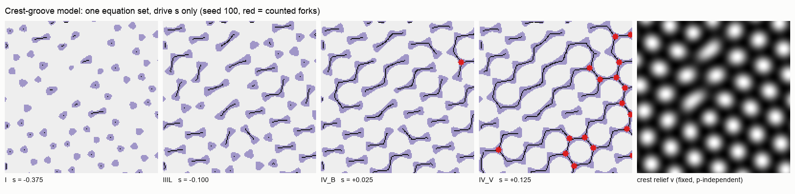
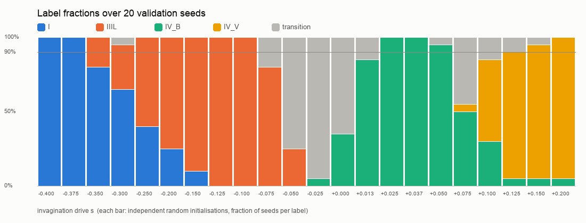
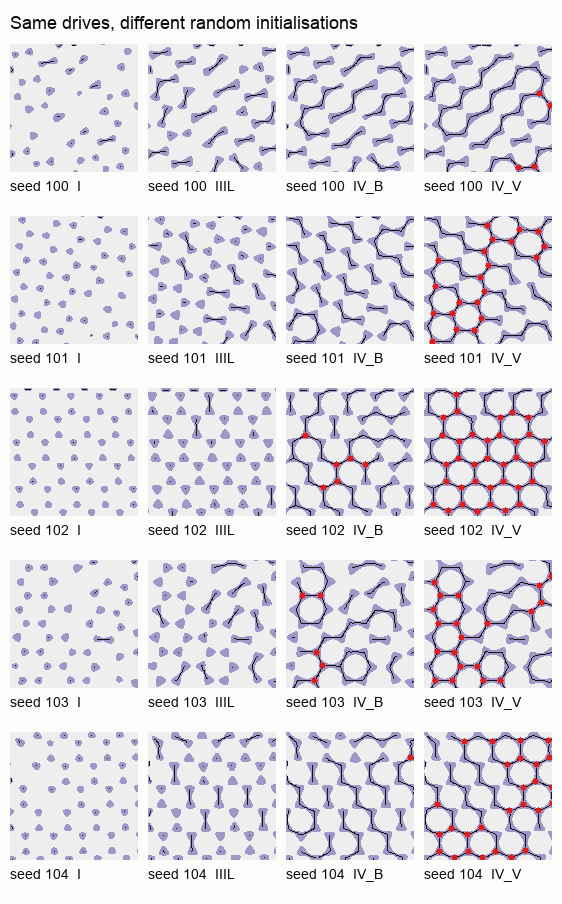
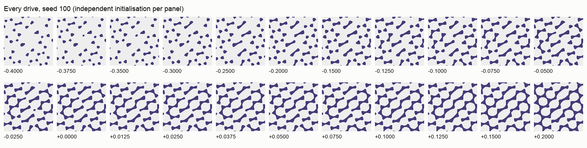
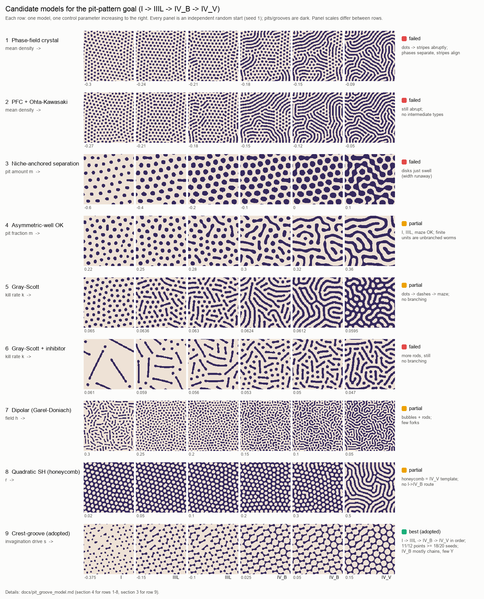

# 畝–溝モデル（crest–groove model）: 一本の駆動量で I → IIIL → IV_B → IV_V

2026-10-10。ゴール: [`pit_pattern_goal.md`](../pit_pattern_goal.md)、検証規約: [`pit_independent_initialization_protocol.md`](../protocols/pit_independent_initialization_protocol.md)。

**結論（暫定）**: 新しい二場モデルで、固定係数・一つの駆動量 \(s\)・毎回独立なランダム初期条件から、I → IIIL → IV_B → IV_V が同じ順序で現れる。溝幅は全段階で I の幅とほぼ同じ（中央値 0.91–0.98 w₀、p90 ≤ 1.37 w₀）。事前登録した 12 点のうち 11 点で、新しい検証 seed 20 個中 18 個以上が目標形態になった。残る弱点は、IV_B の多くが「分岐の多い木の集まり」よりも「ジグザグ鎖とところどころの Y」であることと、形態帯の境界位置が畝格子の乱れ方（初期ノイズ振幅を含む）で動くことである。



*検証 seed 100。左から I（s=−0.375）、IIIL（−0.100）、IV_B（+0.025）、IV_V（+0.125）、右端は固定された畝起伏 v。紫が pit/溝（w>0）、黒が骨格、赤が数えた三叉分岐。全パネル同一の式・係数で、s だけが違い、各パネルは独立に乱数から開始した。*

---

## 1. モデル

周期領域上の二つの場を、どちらも小さな独立乱数から同時に時間発展させる。

\[
\partial_t v = r v - \left(1 + \nabla^2/k_0^2\right)^2 v + g v^2 - v^3
\]
\[
\partial_t w = D\nabla^2 w + w - w^3 - \beta\,(v - s) - \gamma\,\psi,
\qquad (1 - \ell^2\nabla^2)\,\psi = \tfrac12(1 + w)
\]

| 記号 | 意味 | 値（全形態で固定） |
|---|---|---|
| v | 畝（腺口間粘膜）の起伏。二次項つき Swift–Hohenberg で六方格子の畝に自己組織化 | r=0.1, g=1, 畝間隔 2π/k₀ = 24 |
| w | pit の開口スイッチ（双安定）。w>0 を pit/溝として観察 | D=1, β=4 |
| ψ | 開いた pit 面積の遮蔽平均（長距離抑制） | γ=8, ℓ=120（畝 5 個分） |
| **s** | **陥入駆動量。唯一の操作量** | −0.45 … +0.20 |

数値: 256²、dx=1、dt=0.25、半陰的 Fourier 法、T=8000 step（t=2000）。観察閾値 w>0 は全点固定。分類器、画像の切断、Type 別の切替、外部の不均一場は時間発展に一切入らない。

### 1.1 なぜこの形で四形態が出るか

六方格子の畝 v の低い部分は**蜂の巣状の谷（溝）網**になる。三つの畝に囲まれた三重点が深い井戸、隣り合う二つの畝の間（辺の中点）が浅い鞍部である。

1. s が小さいと、深い井戸だけが開く → **規則的な丸 pit（I）**。
2. ある辺の鞍部が s を下回ると、両端の井戸がつながる → **短管（IIIL）**。
3. 一つの井戸から三本の辺が開くと Y。開いた辺の有限クラスタが**分岐した有限の木（IV_B）**。
4. 開いた辺がパーコレーションすると、畝を島として囲む**溝の網（IV_V）**。

溝幅は畝間隔とスイッチ界面で決まり、s では太らない。どの辺から開くかは、乱数初期化から自然に生じる畝格子の乱れ（粒界・転位・間隔のゆらぎ）が決める。外から乱数場を与えてはいない。

長距離抑制 ψ は、開口面積の総量を s のほぼ線形関数に固定する（被覆率は seed によらず s=0 で 0.27±0.01）。これがないとパーコレーションが s の幅 0.005 程度で一気に起き、IV_B 帯がほとんど取れなかった（§4）。抑制距離を畝 1 個分にすると、近傍の辺の同時開口を妨げて Y が消え、鎖だけになった。畝 5 個分の長距離にすると、局所の開口順序はランダムなまま総量だけが s に従う。

---

## 2. 判定規則（検証前に探索 seed 1/7/42 で固定）

[`src/pitpattern/evaluation/evaluate_pit_groove.py`](../../src/pitpattern/evaluation/evaluate_pit_groove.py)。長さは畝間隔 λ=24 px 単位。

| ラベル | 条件 |
|---|---|
| I | 三叉 0、成分伸長比 p90 ≤ 2、骨格長 p90 ≤ λ/4 |
| IIIL | 三叉 ≤ 2、伸長比 p90 > 2、骨格長 p90 ≤ λ、最大成分比 < 0.1 |
| IV_B | 三叉 ≥ 4 かつ三叉を含む成分 ≥ 2、最大成分比 ≤ 0.40 |
| IV_V | 最大成分比 ≥ 0.5、囲まれた畝の島 ≥ 15、三叉 ≥ 20 |
| transition | 上記以外（捨てずに報告） |

幅: すべてのラベルで median/w₀ ≤ 1.5、IV では p90/w₀ ≤ 2.0。w₀=6.13 px は探索 I の幅中央値で、全検証に共通。

三叉の数え方: 既存の `prepare_skeleton_topology` は 8 近傍の次数を数えるので、斜めの太い管の骨格の階段を長さ 1 の枝をもつ接合と誤認し、本物の Y を落とす（実測で、目視で明らかな Y が 0 個と出た）。そこで [`src/pitpattern/metrics/pit_fork_metrics.py`](../../src/pitpattern/metrics/pit_fork_metrics.py) で、交差数（8 近傍を一周したときの 0→1 遷移数）≥3 を接合とし、近接した接合画素を束ね、長さ ≥ λ/4 の骨格線分が 3 本以上出る束だけを三叉とした。斜めの太い棒は 0、Y 字は 1 になることをテストで確認している。既存の goal 指標（幅・最大成分比・島の数など）はそのまま使う。

---

## 3. 結果

### 3.1 独立初期化 20 seed（検証 seed 100–119）



*各棒は 20 個の独立乱数初期化。灰色は transition（未分類）。横線は 90%。*

| s | I | IIIL | IV_B | IV_V | transition |
|---:|---:|---:|---:|---:|---:|
| −0.400 | **20** | 0 | 0 | 0 | 0 |
| −0.375 | **20** | 0 | 0 | 0 | 0 |
| −0.350 | 16 | 4 | 0 | 0 | 0 |
| −0.250 | 8 | 12 | 0 | 0 | 0 |
| −0.150 | 2 | **18** | 0 | 0 | 0 |
| −0.125 | 0 | **20** | 0 | 0 | 0 |
| −0.100 | 0 | **20** | 0 | 0 | 0 |
| −0.075 | 0 | 16 | 0 | 0 | 4 |
| −0.025 | 0 | 0 | 1 | 0 | 19 |
| +0.0125 | 0 | 0 | 17 | 0 | 3 |
| +0.025 | 0 | 0 | **20** | 0 | 0 |
| +0.0375 | 0 | 0 | **20** | 0 | 0 |
| +0.050 | 0 | 0 | **19** | 0 | 1 |
| +0.100 | 0 | 0 | 6 | 11 | 3 |
| +0.150 | 0 | 0 | 1 | **18** | 1 |
| +0.200 | 0 | 0 | 1 | **19** | 0 |

（全 22 点は `artifacts/pit_groove/validation/summary.json`。）

- **20 seed すべてでラベル列が単調**（I→IIIL→IV_B→IV_V の逆行なし）。19 seed で四形態すべてを通過。seed 113 だけは s=0.20 まで IV_B のままで、IV_V に届かなかった。
- 最初に登録した点では、IV_B（0.025/0.0375/0.05）だけが連続 3 点の基準を満たした。I（−0.35）、IIIL（−0.075）、IV_V（0.10/0.125）は境界寄りで 18/20 に届かなかった。

### 3.2 確認（新しい seed 120–139、点は事前登録）

検証結果を見て評価点を選び直したので、§3.1 は探索扱いとした。係数は変えずに点だけを [`preregistration.json`](../../artifacts/pit_groove/confirm/preregistration.json) に書き、新しい seed で確認した。

| 形態 | s | 目標ラベル数 / 20 | 95% Wilson 区間 |
|---|---|---|---|
| I | −0.45 / −0.425 / −0.40 | 20 / 20 / 20 | [0.84, 1.00] |
| IIIL | −0.15 / −0.125 / −0.10 | **17** / 20 / 20 | [0.64, 0.95] / [0.84, 1.00] |
| IV_B | 0.025 / 0.0375 / 0.05 | 20 / 20 / 19 | [0.84, 1.00] / [0.76, 0.99] |
| IV_V | 0.15 / 0.175 / 0.20 | 20 / 20 / 20 | [0.84, 1.00] |

12 点中 11 点が基準（≥18/20）を満たした。IIIL の −0.15 は 17/20（3 seed が I のまま）。§3.1 では同じ点が 18/20 だったので、I–IIIL の境界が −0.15 付近にあると読むのが妥当である。暫定の工学基準であり、90% 以上の母成功率を保証するものではない。

### 3.3 幅と位相（§3.1 と §3.2 の全ラン、各ラベル）

| ラベル | n | 幅中央値 / w₀（中央値・最大） | 幅 p90 / w₀（最大） | 被覆 | 三叉 | 三叉を含む成分 | 成分数 | 最大成分比 | 島 |
|---|---:|---|---:|---:|---:|---:|---:|---:|---:|
| I | 147 | 0.98・1.31 | 1.31 | 0.11 | 0 | 0 | 103 | 0.08 | 0 |
| IIIL | 173 | 0.91・1.04 | 1.31 | 0.21 | 0 | 0 | 120 | 0.04 | 0 |
| IV_B | 162 | 0.91・0.98 | 1.37 | 0.28 | 15 | 5 | 55 | 0.17 | 3 |
| IV_V | 126 | 0.98・0.98 | 1.37 | 0.33 | 100 | 1 | 10 | 0.92 | 38 |

幅の上限（median ≤ 1.5、p90 ≤ 2.0）は全ランで満たした。進行で増えるのは被覆・連結・分岐で、幅ではない。配向の揃い（勾配の二重角平均、平行ストライプ=1）は 256² で中央値 0.05–0.08、最大 0.24、512² で 0.02 だった。平行ストライプではない。ただし小さい領域では、一つの畝粒内で鎖が局所的に揃って見える seed がある（下図の seed 100・104）。



*同じ四つの s、異なる乱数初期化（検証 seed 100–104）。*



*seed 100 の全 22 点（各点で独立初期化）。*

### 3.4 頑健性（seed 120–124、§3.2 の 12 点）

各セルは目標ラベル数 / 5 seed（幅条件込み）。三つの数字は §3.2 の三点の順。

| 条件 | I | IIIL | IV_B | IV_V |
|---|---|---|---|---|
| 初期ノイズ 0.01 | 5 5 5 | 3 5 5 | 5 5 5 | 5 5 5 |
| 初期ノイズ 0.20 | 5 5 5 | 5 5 5 | **3 4 3** | 4 4 5 |
| 時間 2T | 5 5 5 | 3 5 5 | 5 5 5 | 5 5 5 |
| 時間 5T | 5 5 5 | 3 5 5 | 5 5 5 | 5 5 5 |
| dt 半分（0.125、同じ物理時間） | 5 5 5 | 3 5 5 | 5 5 5 | 5 5 5 |
| dx 半分（512²・同じ物理領域） | 4 4 4 | 5 5 5 | 4 4 3 | 3 4 4 |
| 領域 1.5 倍（384²） | 5 5 5 | 5 5 5 | 5 5 5 | 5 5 5 |
| 領域 2 倍（512²） | 5 5 5 | 5 5 5 | 5 5 5 | 5 5 5 |

dx 半分では幅を px で測るので、w₀=12.26、λ=48 px で判定した。

- **時間**: 判定ラベルは 60 例中 58 例が T・2T・5T で同じだった（変化は seed 124 の s=−0.15 が IIIL→I、seed 121 の s=0.05 が transition→IV_B）。ただし二値画像は T→5T で 1–4.5% 変わる。同じ seed ではどの s でもほぼ同じ割合で変わるので、原因は開口スイッチではなく、畝格子 v の粒がゆっくり動き続けることだと考えられる。完全な凍結ではない。T=4000 step では T→2T で 7–15% 動いていたので、T=8000 に定めた。
- **dx 半分**: 幅の比と形態の順序は保たれた。ただし seed ごとの帯の位置は格子収束していない。seed 122 は細かい格子で畝の欠陥が増え、s=−0.45 から短管が出て、IV_B が s=0.175 まで続いた。seed 124 の IV_B 三点は最大成分比 0.41–0.44 で、基準の 0.40 をわずかに超えた。
- **初期ノイズ 0.20** で IV_B が弱くなる。被覆率は変わらないが、畝格子の乱れ方が変わる。seed 124 は格子がきれいに揃って三叉 0 の鎖のまま、seed 122 は早く連結した（最大成分比 0.32–0.49）。形態帯の位置が畝格子の欠陥密度に依存するという、このモデルの性質がそのまま出ている。

---

## 4. 途中で捨てたモデル（同じ判定観点で）

それぞれ数 seed の探索で、ゴールの核心（有限分岐 IV_B と幅一定の両立）を満たさなかった。



*各行が一つのモデル、右へ行くほど操作量が大きい。全パネルとも独立な乱数初期化（seed 1）。行ごとに表示の縮尺は違う。再生成: `.venv/bin/python src/pitpattern/figures/make_model_comparison.py`。*

| 候補 | 何が起きたか |
|---|---|
| 位相場結晶（保存 Swift–Hohenberg）、平均密度を操作量に | spot→stripe が急に切り替わる。共存域では spot 領域と stripe 領域に巨視的に分離し、stripe は平行に揃う |
| 同上 + Ohta–Kawasaki 長距離項 | α を強めても切替は急なまま。中間形態が出ない |
| 非対称二重井戸の Ohta–Kawasaki（低被覆で自発核生成） | I→短管→虫状→迷路は 3 seed で再現し、幅も一定。ただし有限単位は分岐しない虫（ダッシュ）で、三叉は連結してから初めて現れる |
| Gray–Scott（k 走査）、+ 長距離抑制 | spot→短い虫→迷路は seed によらず出る。虫はまっすぐで分岐しない |
| 双極子型長距離（Garel–Doniach） | 泡と短い棒の混合。分岐は少ない |
| 畝ニッチ固定の相分離 | pit が円のまま太るだけ（幅暴走） |
| 畝–溝 + 短距離（畝 1 個分）抑制 | 帯は広がるが、隣接辺の同時開口を禁じるので Y が消えて鎖だけになる |
| 畝–溝 抑制なし | 四形態は出るが、IV_B 帯が s 幅 0.005 程度しかない |

---

## 5. ゴール §7 チェックリストとの対応

| 項目 | 判定 | 根拠 |
|---|---|---|
| s の連続変化で I → IIIL → IV_B → IV_V | ✓ | 20/20 seed で単調、19/20 seed で四形態 |
| IIIL が巨大 blob / 横断線にならない | ✓ | 骨格長 p90 ≤ λ、幅 ≤ 1.04 w₀ |
| IV_B で分岐が見える | △ | 三叉は中央値 15 個・5 成分に分散。ただし単位の多くはジグザグ鎖で、目標図ほど木らしくない |
| IV_B で最長成分が支配しない | ✓ | 最大成分比 中央値 0.17 |
| IV_V が幅一定の網（平行 stripe ではない） | ✓ | 島 中央値 38、配向 ≤ 0.24。形は迷路より蜂の巣に近い |
| 幅 median ≤ 1.5 w₀、IV で p90 ≤ 2.0 w₀ | ✓ | 最大 1.31 / 1.37 |
| 長時間後も保たれる | ✓（形態）/ △（画素） | ラベルは 58/60 で不変。畝格子の緩やかな再配列で画素は 1–4.5% 動く |
| 独立初期化で共通の区間（protocol） | ✓（11/12 点） | §3.2 |
| 不均一場なしで成立 | ✓ | 外部不均一場を使っていない |

## 6. 限界と次の課題

- **IV_B の分岐の少なさ**: 谷網の節点は三重点（次数 3）なので、パーコレーション前の有限クラスタは鎖が多い。井戸ごとに三本の腕を協調して伸ばす機構（井戸での局所活性化など）を入れれば Y の割合が増える可能性がある。
- **境界位置の格子依存**: I/IIIL 境界と IV_B の帯は、畝格子の欠陥密度（初期ノイズ振幅、格子刻み、領域サイズによる歪み）で動く。畝格子はゆっくり再配列し続ける。
- **IV_V の形**: 迷路／脳回というより蜂の巣網。ゴール見本（`goal_target_sweep.png`）の網には近いが、スライド 6 中央の曲がりくねった迷路とは違う。
- 判定の最大成分比は領域サイズに依存する（512² では同じ s で値が小さい）。λ 単位の連結長への置き換えを検討する。
- 生物学的な較正はしていない。v を畝（腺口間粘膜）の起伏、w を陥入スイッチ、ψ を組織規模の抑制と読むのは現象論的な仮説である。

## 7. 再現

```bash
make pit-groove-explore     # 探索 seed 1/7/42
make pit-groove-validate    # 検証 seed 100–119 + 集計 + 図
.venv/bin/python -m pytest tests/test_pit_groove.py
```

実装: [`src/pitpattern/models/simulate_pit_groove.py`](../../src/pitpattern/models/simulate_pit_groove.py)（モデル・スイープ）、[`src/pitpattern/metrics/pit_fork_metrics.py`](../../src/pitpattern/metrics/pit_fork_metrics.py)（三叉）、[`src/pitpattern/evaluation/evaluate_pit_groove.py`](../../src/pitpattern/evaluation/evaluate_pit_groove.py)（判定・集計）、[`src/pitpattern/figures/make_pit_groove_figures.py`](../../src/pitpattern/figures/make_pit_groove_figures.py)（図）。出力は `artifacts/pit_groove/`（git 管理外）。図の写しは `docs/images/pit_groove_*.png`。
