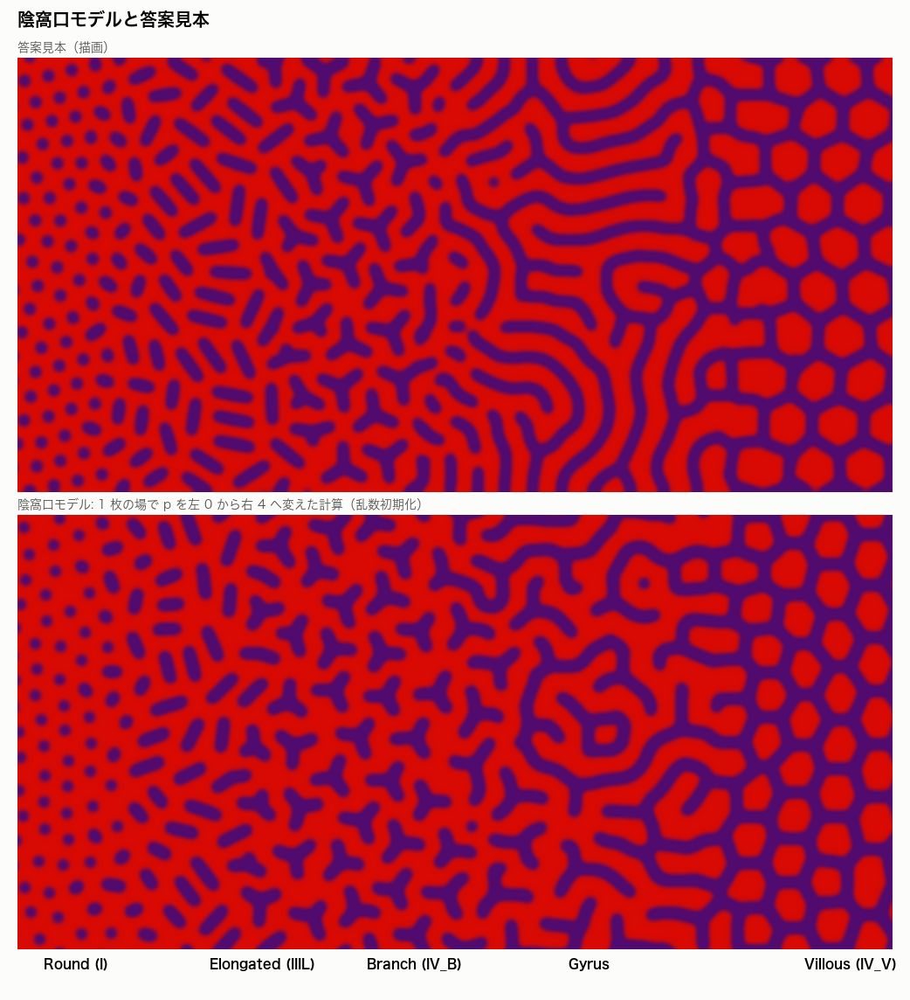
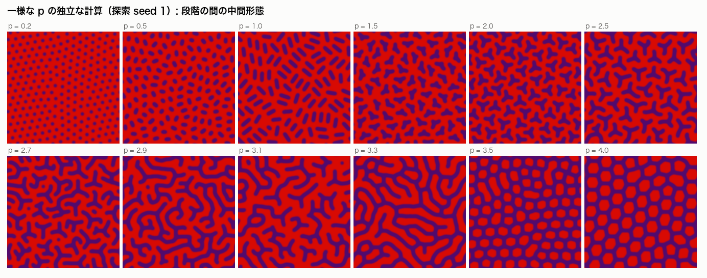
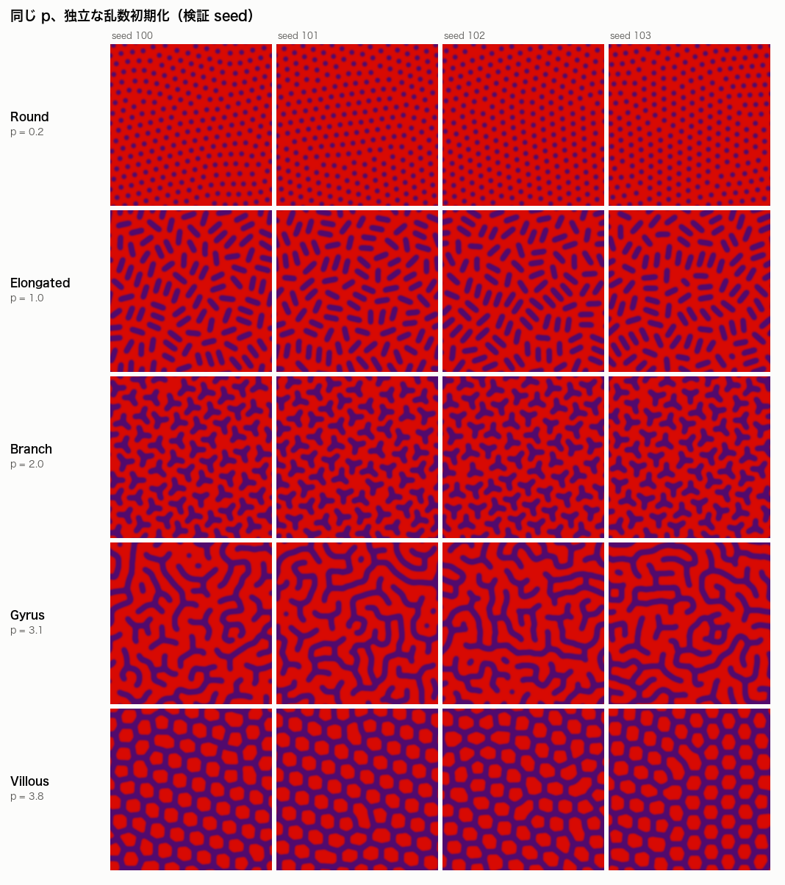

# 陰窩口モデル（crypt-mouth model）: Round → Elongated → Branch → Gyrus → Villous

2026-10-10。ゴール: [`pit_pattern_goal.md`](../pit_pattern_goal.md)、検証規約: [独立初期化 protocol](../protocols/pit_independent_initialization_protocol.md)。

**結論**: 固定した係数・1 本の進行度 \(p\)（0〜4）・毎回独立な乱数初期条件から、答案見本の 5 段階が順に再現した。事前登録した 15 点（各段階 3 点）すべてで、検証 seed 20 個中 **19 個以上**が目標の段階になった（13 点は 20/20、2 点は 19/20）。溝の太さは全段階で 1.00〜1.06 w₀、基準時間の 5 倍まで計算しても判定は変わらない。ただし \(p\) に対する各係数の変え方（陰窩口の形、陰窩の密度、場の係数）はモデルの**仮定**であり、組織の量から導いたものではない（§4）。



*上: 答案見本（描画）。下: このモデルの 1 枚の場で、\(p\) を左 0 から右 4 へ変えた計算。色・ぼかしは同じ描画規則。*

## 1. モデル

**生物学的な読み**: 陰窩の数は保たれたまま、進行とともに 1 つの陰窩の口が伸び（Elongated）、分岐し（Branch）、さらに伸びて隣とつながり（Gyrus）、最後は粘膜のほうが島として残る（Villous）。隆起して表面積が増えるぶん、単位面積あたりの陰窩は減る。

2 つの層を重ねる。係数はすべて \(p\) だけの固定した関数。

### 1.1 陰窩口の層（単位）

1. \(N(p)\) 個の陰窩を、周期領域の一様乱数の位置・向きに置く。
2. 各陰窩は \(p\) で決まる 1 つの溝を持つ。\(p\) 0→1 で点がまっすぐな管（長さ 36 px）に伸び、1→2 で 3 本目の腕が出て腕 24 px の Y になる。
3. 溝どうしが間隔 \(D\)（I の点の間隔 27.5 px）より近づかないよう、軟らかい反発で位置と向きを緩和する。
4. \(p>2\) では腕の先端がさらに伸びる。他の溝から一定の距離を保ち、ときどき分岐し、陰窩あたりの長さの予算（最大 420 px）を使い切るか、進めなくなったら止まる。

### 1.2 粘膜の場

場 \(u\)（\(u>0\) が溝）は、陰窩口の型 \(T\)（溝で +1、粘膜で −1）に留められた Swift–Hohenberg 型の勾配流に従う。場自体は小さなノイズから始める。

\[
\partial_t u = r\,u - \Bigl(1 + \frac{\nabla^2}{k(p)^2}\Bigr)^{2} u - u^3 + g(p)\,u^2
 + \kappa(p)\,(T - u) + \kappa_g(p)\,P\,(u_p - u)
\]

\(P\) は成長した溝の上だけ 1、\(r = 0.2\)、\(u_p = 0.7\)。

| 係数 | 意味 | Round〜Branch（\(p \le 2.2\)） | Gyrus（\(p \approx 3\)） | Villous（\(p \ge 3.6\)） |
|---|---|---|---|---|
| \(\kappa\) | 場を陰窩口の型に一致させる強さ | 1.5（場 = 単位そのもの） | 0 | 0 |
| \(\kappa_g\) | 成長した溝の上だけ場を溝に保つ強さ | 0 | 0.5（\(p=3.2\) で 0.3） | 0 |
| \(2\pi/k\) | 溝の間隔 | \(D\) | 1.25 \(D\) | 1.6〜1.8 \(D\) |
| \(g\) | 溝と粘膜の非対称 | +0.6 | +0.6（\(p=3.2\) で +0.25） | −0.8〜−1.0（粘膜が島になる） |
| 陰窩あたりの面積 | 表面の拡大 | 形に合わせて増える | Branch の 2.5 倍 | Branch の 4 倍 |

- \(\kappa\) が大きい間は、場は陰窩口の形をそのまま写す。
- Gyrus では \(\kappa \to 0\)、\(\kappa_g > 0\)。成長した溝は残り、溝のない所は場が自分の間隔で埋めてつなぐ。\(\kappa_g\) がないと、場は時間とともにまっすぐな平行縞に均されてしまう（§3）。
- Villous では留める項が消え、\(g<0\) により縞が切れて粘膜が島になる。

### 1.3 描画

\(u>0\) の中心線を、全段階共通の一定の太さ（13.5 px）で描き直し、答案見本と同じぼかし・配色にする。実装: [`src/pitpattern/models/simulate_pit_mouth.py`](../../src/pitpattern/models/simulate_pit_mouth.py)。周期領域 440 × 440 px（点の間隔の 16 倍）。

### 中間形態



*\(p\) ごとに独立に計算したもの（探索 seed 1）。短い楕円（0.5）、腕の短い Y（1.5）、腕の伸びた Y（2.5）、つながり始め（2.7）、細長い島（3.3）が段階の間に現れる。*

## 2. 検証

**判定規則**（探索 seed 1・7・42 で固定）。描画した 2 値画像だけから、紫の連結成分を中心線の長さと自由端の数で分類する。

| 判定 | 条件 |
|---|---|
| Round | 成分の 90% 以上が点（伸長比 < 1.5） |
| Elongated | 成分の 90% 以上が管（自由端 2、長さ < 3 \(D\)） |
| Branch | 成分の 75% 以上が Y（自由端 3）、かつ Y と管で 90% 以上 |
| Villous | 赤の面積の 70% 以上が、囲まれた島 |
| Gyrus | 中心線の 70% 以上が長い溝（> 6 \(D\)）、かつ島の面積が赤の 35% 以下 |
| transition | 上のどれでもない |

点・判定規則・係数を [`preregistration.json`](../../artifacts/pit_mouth/validation/preregistration.json) に書いてから、検証 seed 100〜119 を走らせた。基準時間は場の 900 ステップで、その 2 倍・5 倍でも判定した。

| 段階 | \(p\) | 目標の判定 / 20 | 太さ中央値 / w₀ | 太さ p90 / w₀（最大） | 溝の隙間 / I の隙間 | 5 倍の時間で判定が同じ / 20 | 5 倍の時間で変わった画素（最大） |
|---|---|---|---:|---:|---:|---|---:|
| Round | 0.1 / 0.2 / 0.3 | 20 / 20 / 20 | 1.00 | 1.06 | 0.93 / 1.00 / 1.12 | 20 / 20 / 20 | 0 |
| Elongated | 0.8 / 1.0 / 1.2 | 20 / 20 / 20 | 1.00 | 1.09 | 1.09 / 1.12 / 1.16 | 20 / 20 / 20 | 0 |
| Branch | 1.8 / 2.0 / 2.2 | 20 / 20 / 19 | 1.06 | 1.09 | 1.05 / 1.02 / 1.07 | 20 / 20 / 20 | 0 |
| Gyrus | 3.0 / 3.1 / 3.2 | 19 / 20 / 20 | 1.06 | 1.09 | 1.40 / 1.49 / 1.51 | 19 / 20 / 20 | 2.3% |
| Villous | 3.6 / 3.8 / 4.0 | 20 / 20 / 20 | 1.06 | 1.09 | 1.84 / 1.98 / 2.15 | 20 / 20 / 20 | 35% |

- w₀ = Round の pit の直径（13.2 px）。20/20 の 95% Wilson 下限は 0.84、19/20 は 0.76。
- 外れた 2 件はどちらも transition（\(p=2.2\) の seed 109、\(p=3.0\) の seed 118）で、別の段階と判定されたものはない。
- 太さは描画で一定にしている。描き直す前の場 \(u>0\) の太さは、Branch まで 1.06〜1.18 w₀、Gyrus で 1.49 w₀、Villous で 1.27〜1.37 w₀。
- 「溝の隙間」は赤い部分の幅の中央値。Gyrus の 1.4〜1.5 倍は、溝の間隔（隙間 + 太さ）にすると約 1.3 倍にあたる。



*同じ \(p\)、独立な乱数初期化（検証 seed 100〜103）。配置は毎回違うが形態は同じ。*

**探索の全走査**（seed 1・7・42、33 点）: Round \(p \le 0.4\)、Elongated 0.6〜1.4、Branch 1.5〜2.5、Gyrus 2.9〜3.2、Villous \(p \ge 3.5\)。3 seed で区間は一致した。間の \(p = 0.5\)、2.6〜2.8、3.3〜3.4 は transition。

**頑健性**（探索 seed、各段階の中央の 5 点 × 3 seed）: 時間刻みを半分、場の初期ノイズを 0.01 と 0.05（既定 0.15）、領域を 1.5 倍と 2 倍にした 75 回すべてで目標の判定になった。

## 3. 限界

- **Gyrus が答案見本より短く、分岐が多い**。見本や参照画像の「長くなめらかな溝が並走する」感じには届いていない。成長した溝に場を留めているためで、留めを弱めると長くなめらかになるが、時間とともに平行縞に均される。
- **Villous の島は陰窩と対応しない**。留める項が消えるので、島の数（1 視野に約 70〜90 個）は場の間隔で決まり、陰窩の数（約 18 個）とは無関係になる。「陰窩の数が保たれる」という読みは Gyrus までしか表現していない。
- **Villous は配置が動き続ける**。島の格子の欠陥が動くため、5 倍の時間で画素の約 3 割が入れ替わる。島の数と判定は変わらない。
- **太さ一定は描画による**。場そのものの太さは Gyrus で 1.49 w₀ と、基準（1.5）ぎりぎり。
- **隙間は Round〜Branch で完全には一定でない**（I の 0.93〜1.16 倍）。密度の決め方が形の変化と少しずれている。
- **Gyrus の区間が狭い**（\(p\) 2.9〜3.2）。両側に transition が 0.2〜0.3 ずつある。
- **検証していないこと**: 相関のある初期ノイズ、空間格子を細かくした計算、5 倍を超える時間。

## 4. 何が仮定で、何が自発的か

| 自発的（乱数初期化から決まる） | 仮定（モデルに入れたもの） |
|---|---|
| 陰窩の配置と向き、詰まり方 | 陰窩口の形が \(p\) で 点 → 管 → Y と変わること、その長さ |
| 腕がどこへ伸び、どこで分岐し、どこで止まるか | 陰窩の密度と腕の長さの予算の \(p\) 依存 |
| 溝どうしがどこでつながるか、脳回の形 | 場の係数 \(\kappa, \kappa_g, k, g\) の \(p\) 依存 |
| 島の配置と格子の向き、欠陥 | 溝を一定の太さで描くこと |

係数の \(p\) 依存は「答案見本の順に並ぶように」選んだもので、陰窩分葉モデル（[`pit_crypt_model.md`](pit_crypt_model.md)）の「価数が \(p\) で増える」と同じ種類の仮定である。次の課題は、これらを細胞・組織の量（陰窩口の周長の成長、間質の張力、表面の拡大率など）から導くことと、Villous の島を陰窩と結びつけること。

## 5. 再現

```bash
make mouth-gui             # GUI: p のスライダーで Round → Villous、係数も動かせる
make pit-mouth-explore     # 探索 seed 1・7・42、33 点
make pit-mouth-validate    # 検証 seed 100–119 + 集計
make pit-mouth-sweep       # 横長の 1 枚（p を左→右に変化）
make pit-mouth-figures     # docs/images/pit_mouth_*.png
uv run python -m pytest tests/test_pit_mouth.py
```

集計: [`src/pitpattern/evaluation/evaluate_pit_mouth.py`](../../src/pitpattern/evaluation/evaluate_pit_mouth.py)、図: [`src/pitpattern/figures/make_pit_mouth_figures.py`](../../src/pitpattern/figures/make_pit_mouth_figures.py)。出力は `artifacts/pit_mouth/`（git 管理外）。
