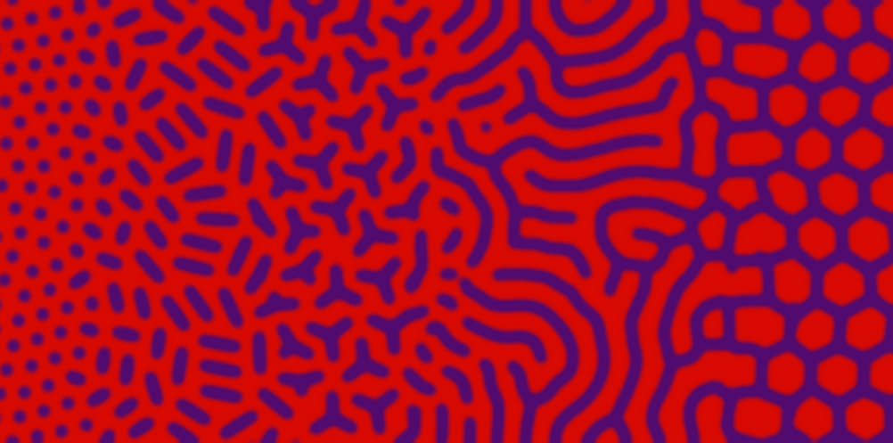

# Pit pattern シミュレーション — ゴール定義

**どのような結果が出れば成功か**を固定する文書。機構（反応拡散・座屈・Voronoi など）や数式はここでは決めない。新しいモデルは、まずこの文書に照らして合否を付ける。形態の参照は [`serrated_pitpattern.pptx`](serrated_pitpattern.pptx)、医学的背景は [`pit_pattern_literature.md`](pit_pattern_literature.md)。

---

## 1. ゴール

**固定した係数のまま 1 本の連続パラメータ \(p\) を動かすと、模様が**

```text
Round (I)  →  Elongated (IIIL)  →  Branch (IV_B)  →  Gyrus (IV)  →  Villous (IV_V)
```

**の順に、なめらかに変わる。溝（pit）の太さは全段階で一定。溝どうしの赤い隙間は Branch まで一定で、Gyrus から Villous に向けて徐々に広がる。それ以外に変わるのは長さ・分岐・つながり方だけ。**

- 「Type らしい絵を別々の設定で描く」ことではない。スライド 6 の「I → IIIL → IV_B → IV_V の変化は連続的に表現できる」が本質。
- 想定する組織像（2026-10-10）: 陰窩の底部の増殖帯は進行しても I 型のような均一な点の並びのまま。表層に上がるにつれ陰窩の口が開いて、1 つの陰窩の口が伸び（IIIL）、分岐し（IV_B）、さらに伸びて脳回状に詰まり（Gyrus）、隣と融合して粘膜が島（絨毛）になる（IV_V）。**陰窩の数は保たれ**、隆起型では表面積が増えるぶん単位面積あたりの陰窩の数が減る。
- **独立初期化での再現性が必須**。共通の規則で作った複数のランダム初期条件から、同じ \(p\) 区間で同じ形態が出ること（画素配置の一致は求めない）。前の形態を引き継ぐ continuation や空間勾配の 1 枚だけでは合格にしない。手順は [独立初期化 protocol](protocols/pit_independent_initialization_protocol.md)。

## 2. 答案見本



*左から Round → Elongated → Branch → Gyrus → Villous。紫 = pit・溝、赤 = 粘膜。プログラムによる描画で、シミュレーション結果ではない（[`src/pitpattern/figures/make_pit_gyrus_sweep.py`](../src/pitpattern/figures/make_pit_gyrus_sweep.py)）。点の間隔 27.5 px、溝の太さ約 13 px、色はスライド 6 の実測値。溝の間隔は Branch まで点の間隔と同じで、Gyrus で約 1.25 倍、Villous で蜂の巣の間隔まで広がる。上下比較は [`pit_gyrus_sweep_compare.png`](images/pit_gyrus_sweep_compare.png)。*

| 段階 | 目標像 |
|---|---|
| **Round（I）** | 赤地に紫の丸い点が、ほぼ規則的に並ぶ |
| **Elongated（IIIL）** | 各陰窩の点がその場で伸びた**まっすぐな管**。短い楕円から長い管（点の約 2.5 倍）へ**徐々に**伸びる。管どうしは離れ、赤い隙間は I と同じ |
| **Branch（IV_B）** | 各陰窩が**腕の長い Y**（分岐 1 回、腕は溝の太さの約 2 倍）。Y どうしは離れ、赤い隙間は I と同じ |
| **Gyrus（IV）** | Y の腕がさらに伸びて隣とつながり、**長くなめらかな溝が並走しながら曲がり・分岐する脳回状の模様**になる。短い断片から長い溝へ徐々に長くなる。溝の太さは一定、溝の間隔は I の約 1.25 倍まで徐々に広がる（まっすぐな平行ストライプではない） |
| **Villous（IV_V）** | 畝が横切る溝で切られて**細長い島**になり、丸まって**規則的な島（絨毛）**に落ち着く。溝は一定幅の網になる。島は I の点より大きい（現在の見本で等価径約 2.5 倍） |

- **各段階はその形態だけで模様を作る**。隣の形態が混ざってよいのは移行領域だけ。
- **単位は勝手に伸び続けない**。管・Y・迷路の長さは \(p\) で決まり、時間がたっても変わらない。

### 参照: スライド 6 の反応拡散スイープ


*`serrated_pitpattern.pptx` スライド 6。**右端**が赤地に紫の点（I）。太さ・間隔・並び方・質感は理想的。ただし中ほどでは紫の管が伸び続けて長いストライプになっており、そこが目標と違う。*

## 3. 判定基準

### 3.1 必須（Must）

- [ ] \(p\) の連続変化で **Round → Elongated → Branch → Gyrus → Villous** の順に移る（逆行しない、段階を飛ばさない）
- [ ] **なめらかさ**: 隣の段階の間に中間形態がある（管が徐々に伸びる、Y の腕が伸びてつながり脳回になる、畝が細長い島に切れて丸い島になる）
- [ ] **段階の純度**: Elongated はほぼ管だけ、Branch はほぼ Y だけ（I の点が多く残らない）
- [ ] **隙間**: Branch まで、溝どうしの赤い隙間が I の点どうしの隙間とほぼ同じ。Gyrus から Villous へは**徐々に**広がる（急に広がらない）。どの段階でも溝どうしがぶつからず、大きな空白を残さない
- [ ] **幅**: 溝の太さが全段階で一定（`feature_width_median / w₀ ≤ 1.5`、p90 ≤ 2.0。w₀ は I の pit の開口径）。数珠状・塊にならない
- [ ] **Villous**: 一定幅の溝の網に、粘膜の島が規則的に残る
- [ ] 十分長い時間のあとも上記が保たれる
- [ ] 独立初期化で共通の \(p\) 区間に再現する（§1、protocol）

### 3.2 定量の目安（暫定）

指標の実装は [`src/pitpattern/metrics/pit_goal_metrics.py`](../src/pitpattern/metrics/pit_goal_metrics.py)、三叉の数え方は [`src/pitpattern/metrics/pit_fork_metrics.py`](../src/pitpattern/metrics/pit_fork_metrics.py)。

| 指標 | Round | Elongated | Branch | Gyrus | Villous |
|---|---|---|---|---|---|
| 溝の太さ / w₀ | ≈ 1.0 | ≈ 1.0 | ≈ 1.0 | ≈ 1.0 | ≈ 1.0 |
| 単位の形 | 丸（伸長比 ≲ 2） | 管（伸長比 2→4） | 三叉 1 個の Y | 分岐・屈曲した長い溝 | 網（粘膜が島） |
| 溝の間隔 / I の点の間隔 | 1 | ≈ 1 | ≈ 1 | 1 → 約 1.25（空白なし） | 約 2（島の間隔） |
| 最長成分比 | 低 | 低 | 低 | 中→高 | 高 |

数値は画像とセットで読む。数値が合っていても、絵が幅暴走・平行ストライプ・空白だらけなら不合格。

### 3.3 反例

| 反例 | 何が起きているか |
|---|---|
| 平行ストライプ（[`anti_goal_parallel_stripes.png`](images/anti_goal_parallel_stripes.png)） | 分岐も迷路もない偽 IV |
| 分岐のない断片（[`anti_goal_dashes.png`](images/anti_goal_dashes.png)） | 線を切って Y まで消した偽 IV_B |
| 幅の暴走（[`anti_goal_thick.png`](images/anti_goal_thick.png)） | 太い塊・塗りつぶしを IV と呼んでいる |
| 管が最初から伸び続けて長い溝になる | スライド 6 中ほどの状態。Elongated・Branch を飛ばしている |
| 溝どうしがぶつかる／大きな空白が残る／隙間が急に広がる | 隙間の基準を満たさない |
| 設定ごとに別の式・別の初期条件 | 連続パラメータ変化ではない |

### 3.4 今は対象外

Type II / II-L / II-O、III_H、IV_H（シダの葉・松毬様）、Type VI / VN の再現、臨床診断精度・病理対応、特定の方程式への固定。

## 4. 参照ファイル

**規範（ゴールを定義するもの）**

| ファイル | 内容 |
|---|---|
| [`images/pit_gyrus_sweep.png`](images/pit_gyrus_sweep.png) | 答案見本（まずこれと見比べる）。比較図 [`pit_gyrus_sweep_compare.png`](images/pit_gyrus_sweep_compare.png) |
| [`images/goal_rd_sweep_i_to_iv.png`](images/goal_rd_sweep_i_to_iv.png) | スライド 6。太さ・間隔・質感の参照 |
| [`images/Gemini_Generated_Image_us446ius446ius44.jpeg`](images/Gemini_Generated_Image_us446ius446ius44.jpeg) | 生成画像による参照。Gyrus の溝の長さ・なめらかさと、Gyrus → Villous の移り方はこれに寄せた。にじみや団子状の Y など生成画像由来の乱れは規範に含めない |
| [`images/pit_reference_sheet.png`](images/pit_reference_sheet.png) | 手元の実画像（工藤分類表・鋸歯状病変）の参照シート |
| [`images/anti_goal_*.png`](images) | 反例（§3.3） |
| [`serrated_pitpattern.pptx`](serrated_pitpattern.pptx) | 鋸歯状 pit の整理スライド |

答案見本の変遷: [`pit_ideal_sweep.png`](images/pit_ideal_sweep.png)（2〜3 個の点をつなぐ 4 帯。IV_V = I の明暗反転）→ [`pit_gap_sweep.png`](images/pit_gap_sweep.png)（1 陰窩 = 1 単位・隙間一定）→ [`pit_grade_sweep.png`](images/pit_grade_sweep.png)（なめらかな移行・蜂の巣の Villous）→ Gyrus を新設（隙間は Gyrus まで一定、2026-10-10）→ 現行（長くなめらかな脳回、Gyrus から隙間が広がる、畝が島に切れる Villous。2026-10-10）。旧版の [`goal_target_sweep.png`](images/goal_target_sweep.png)・[`goal_schematic_i_iiil_ivb_ivv.png`](images/goal_schematic_i_iiil_ivb_ivv.png) も規範ではない。

**実績（シミュレーション結果。規範ではない）**

| ファイル | 内容 |
|---|---|
| [`pit_crypt_model.md`](models/pit_crypt_model.md) | **陰窩分葉モデル**（2026-10-10）: 旧答案見本（`pit_ideal_sweep.png`）の 4 帯を独立初期化 20 seed × 12 点で再現。価数の変化は仮定 |
| [`pit_groove_model.md`](models/pit_groove_model.md) | 畝–溝モデル（2026-10-10）の結果と限界 |
| [`images/pit_model_comparison.png`](images/pit_model_comparison.png) | これまでの候補モデル 9 種の比較 |
| [`images/goal_all_results_one_page.png`](images/goal_all_results_one_page.png) | 空間勾配モデルのサマリー（[`pit_progression_model.md`](models/pit_progression_model.md)） |

臨床写真・文献図を加えるときは出典を明記し、形態の参考であって診断の根拠ではないと添える。手段（飽和・座屈・fission など）がゴールを再定義しないこと。
