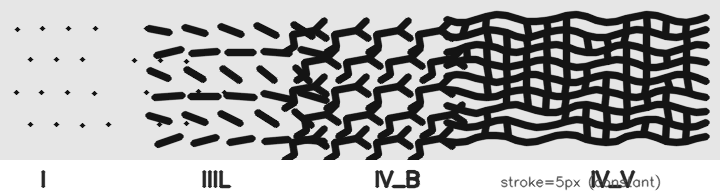
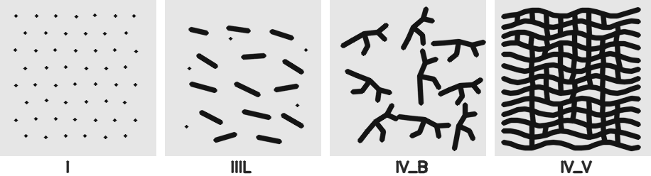
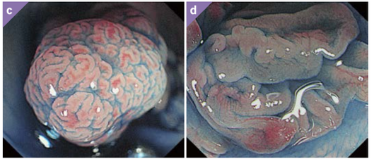

# Pit pattern シミュレーション — ゴール定義

この文書は、**どのような結果が出れば成功か**を先に固定するためのものである。  
数式・実装・どの機構（反応拡散 / 座屈 / Voronoi 等）を使うかはここでは決めない。  
モデル候補を評価するときは、まずこのゴールに照らして「近い / 遠い」を判断する。

形態の参照として [`serrated_pitpattern.pptx`](serrated_pitpattern.pptx)（「“鋸歯状”Pit patternを整理する」）を用いる。  
医学的な Type 定義の背景は [`pit_pattern_literature.md`](pit_pattern_literature.md)、既存の評価手順は [`pit_model_evaluation.md`](pit_model_evaluation.md) を参照。

---

## 1. 一言で言うゴール

### 2026-09-15追加: 初期条件に対する再現性を主条件にする

各パラメータを最初から固定し、共通の規則で生成する複数のランダム初期条件から、同じ形態群が再現することを必要条件とする。同じ画素配置は要求しない。四形態それぞれに、初期条件ごとに選び直さない共通のパラメータ区間が必要である。

前の形態を引き継ぐcontinuationや空間勾配画像だけでは合格にしない。有限時間の停止と、広い初期条件集合からの再現性も区別する。固定の不均一場を使う場合は、初期条件のseedと不均一場のseedを独立に変更し、不均一性なしの対照を置く。具体的な検証は [独立初期化protocol](pit_independent_initialization_protocol.md) に従う。

> **進行で変わってよいのは長さ・分岐・被覆。変わってはいけないのは幅。**

**1 本の連続パラメータを動かすだけで、視野内の模様が**

```text
Type I  →  Type III（とくに IIIL）  →  Type IV_B（branching）  →  Type IV_V（labyrinth / gyrus）
```

**と段階的に変わり、かつ IIIL / IV_B / IV_V でも個々の pit（溝の幅・単位構造の太さ）が不自然に膨らみすぎない。**

スライド 6 の文言どおり、**「I → IIIL → IV_B → IV_V の変化は連続的に表現できる」**ことが本質である。  
「Type っぽい絵を別々の config で描く」ことではない。

### 2026-10-10改訂: 答案見本を差し替え、IV_V を「I の明暗反転」と定める

**答案見本（現行）**: スライド 6 の反応拡散スイープの太さ・間隔・規則的な並び・質感はそのまま保ち、IIIL と IV_B の単位が伸び続けずに止まるよう描き直したもの。


*左から I → IIIL → IV_B → IV_V。紫が pit・溝、赤が粘膜。プログラムによる描画であり、シミュレーション結果ではない（`src/make_pit_ideal_sweep.py`）。点の間隔 27.5 px、紫の太さ 12–14 px、色はスライド 6 の実測値。上下比較は [`pit_ideal_sweep_compare.png`](images/pit_ideal_sweep_compare.png)。*

| 帯 | 目標像 |
|---|---|
| I | 赤地に紫の丸い点が三角格子状に規則的に並ぶ |
| IIIL | **帯の中の点はほぼすべて**、隣の点 1 つとだけつながった**まっすぐな短管**（長さは点の約 3 倍）。管どうしは離れ、伸び続けない |
| IV_B | **帯の中の点はほぼすべて**、3 点が 1 か所でつながった **Y 字**か、Y が 2 つ程度つながった小さな樹。輪を作らず、有限の大きさで止まる |
| IV_V | Y どうしが閉じて紫の網になり、**赤い点（粘膜）が I と同じ間隔・ほぼ同じ径で残る**。すなわち **I の明暗反転** |

- 紫の太さは全帯で同じ。変わるのはつながり方（点 → 短管 → Y → 網）だけ。
- **各帯はその形態だけで模様を作る**。I の点が IIIL・IV_B の帯に多く混ざるのは不合格。隣の形態が混ざってよいのは帯の境界（移行領域）だけ。
- IV_V の正解像は、旧版で書いた「スライド 6 中央の迷路相」ではなく、上記の明暗反転（スライド 6 では左端にあたる）とする。以下の節で IV_V を「迷路／脳回網」と書いている箇所は、この定義で読み替える。

参照（pptx スライド 6）:


*参照: `serrated_pitpattern.pptx` スライド 6。**右端**が赤地に紫の規則的な点（I）、**左端**が紫地に赤い点（I の明暗反転 ＝ IV_V の正解像）。中ほどでは紫の管が伸び続けて長いストライプ・迷路になっており、ここが目標と違う点である（旧版の説明は左右を取り違えていた）。太さ・間隔・並び方・質感は理想的。*

旧版の合成ターゲット（線幅一定、参考として残す）:



*`make goal-figures` による旧版の見本。IV_V を密な網目として描いている。*

---

## 2. 本ゴールが採用する Type 軸

工藤分類の Type IV を、本プロジェクトでは次の **2 段階**に分けてゴールにする。

| 記号 | 呼び方 | 形態の核 | pptx 上の位置づけ |
|------|--------|----------|-------------------|
| **I** | Type I | 規則的な丸 pit | 正常側の起点 |
| **III**（主に **IIIL**） | Type IIIL | やや大きい／短い管状 pit | I の次。まだ分岐の主役ではない |
| **IV_B** | Type IV branching | **短い〜中程度の分岐**（有限長の樹状・細かい網） | 鋸 IV_B。III から進んだ分岐相 |
| **IV_V** | Type IV villous / gyrus | **幅一定のまま密に連結した迷路／脳回網** | 鋸 IV_V。スライド 6 中央の labyrinth 相 |

```text
  進行度（パラメータ p）小 ─────────────────────────────→ 大

  I          IIIL           IV_B              IV_V
  丸・規則    短管状・有限    短い分岐が主役      密な迷路／脳回網
  ● ● ●      ○ ∪ ○         Y─∪─Y            ╱╲╱╲╱╲
  ● ● ●      ○ ○ ∪         ∪─Y─∪            背景が島になる網
```


### 2.1 なぜ IV を B と V に分けるか

臨床・整理スライドでは、Type IV 相当でも **短い分岐が主役の段階（IV_B）** と、**さらに連結が進み迷路／脳回状になった段階（IV_V）** が区別される（`serrated_pitpattern.pptx` スライド 3・6・7）。

スライド 6 の RD スイープが示すとおり、IV_V は「葉状の平行溝」ではなく、**特徴幅を保ったまま溝が曲がり・分岐・連結した labyrinth / gyrus** である。

ゴールは次の順序を守ることである。

1. まず **IV_B**: 分岐はあるが、単位はまだ比較的短く、複数の有限長ツリー。
2. その先で **IV_V**: 連結が進み、密な迷路／脳回網になる。ただし **溝幅の暴走**（太い blob・塗りつぶし）は望ましくない。幅一定の迷路網そのものは目標であり、反例ではない。

### 2.2 本ゴールの主系列と、いま必須にしない系列

| 系列 | 内容 | 本ゴールでの扱い |
|------|------|------------------|
| **主系列** | I → IIIL → IV_B → IV_V | **必須**。連続パラメータで再現したい軸 |
| 鋸歯状 II 系 | II / II-L / II-O、III_H、IV_H（シダの葉・松毬様など） | 参照のみ。主系列の成功後に拡張候補 |
| VI / VN | 不整・無構造 | 主系列の外側。別ゴール |

スライド 7 では鋸歯状亜型と通常 Type の対応（例: III_H ↔ II-L、IV_H ↔ 鋸 IV_B / IV_V）が整理されているが、**シミュレーションの第一目標は主系列の連続遷移**とする。

---

## 3. 観察の前提（何を見ているか）

拡大内視鏡の top-view と同じく、**粘膜表面に開いた腺口（pit）／溝の平面模様**を見る。

| 記号 | 意味 |
|------|------|
| ● / ○ | 丸〜類円形の pit 開口 |
| ─ / ∪ | 管状にやや伸びた pit |
| Y / ⊥ | 短い分岐（楔形・樹枝の局所）＝ **IV_B の核** |
| ╱╲網 | 幅一定の迷路／脳回状の連結網＝ **IV_V の核** |

pit / 溝は「塗りつぶし領域」でも「線」でもよい。重要なのは次の 2 点である。

- **位相（トポロジー）**が I → 短管 → 短い分岐 → 密な迷路網 と進むこと
- **特徴幅（線の太さ・開口の直径）**が、進行しても極端に膨らまないこと

---

## 4. 各段階の目標像（絵と参照）

合成模式図（線幅一定・`make goal-figures`）:



*左から Type I → IIIL → IV_B → IV_V。点 → 短い弧 → 短い分岐樹 → 密な迷路／脳回網。4 パネルとも同じ stroke 幅。*

臨床参照（IV_B と IV_V）:



*出典整理は `serrated_pitpattern.pptx` スライド 3。臨床でも溝幅は比較的細く保たれ、複雑さは長さ・分岐・連結で増える。*

### 4.1 Type I — 規則的な丸 pit

```text
  ・  ・  ・  ・  ・
    ・  ・  ・  ・
  ・  ・  ・  ・  ・
    ・  ・  ・  ・
  ・  ・  ・  ・  ・
```

- ほぼ同じ大きさの円形 pit が、ほぼ等間隔に並ぶ。
- 分岐なし。細長い線なし。
- **サイズ感**: 正常粘膜。視野に多数の開口が並ぶイメージ。
- ここでの `feature_width_median` を **基準幅 \(w_0\)** とする（§6.2）。

### 4.2 Type IIIL — やや大きいが有限な管状・類円形

```text
   ○   ○    ○
     ○   ∪   ○
   ○   ○    ○
     ∪   ○   ○
```

- I より **やや大きい** round / short tubular。
- **重要**: 「大きい」は相対語。**視野を横断する巨大 blob や長い 1 本の溝ではない**。
- 分岐はあっても **局所的な Y 字が少数**（まだ IV_B ではない）。
- 幅: `feature_width_median / w₀ ≤ 1.5`（暫定）。開口面積は 2–3 倍まで許容、アスペクト比はおおむね ≤ 3。

望ましい IIIL（あってもよい局所分岐）:

```text
        ／
   ○───●───○     ← 短い 2〜3 枝。各枝はすぐ終わる
        ＼
```

避けたい IIIL（→ [`anti_goal_thick.png`](images/anti_goal_thick.png)）:

```text
   ████████████████     ← 巨大な塗りつぶし / 合体した巨大 pit
   ─────────────────    ← 1 本が画面端から端まで伸びる
```

### 4.3 Type IV_B — branching（樹枝・細かい脳回）

**IV の第一段階。** 分岐が模様の主役になるが、単位はまだ比較的短い。

```text
   ∪─∪   Y─∪    ∪─∪
     ＼／   ＼／    │
   ∪──Y──∪  ∪──∪──Y
     ／＼        ／
   ∪─∪   ∪──Y──∪
```

目標の性質:

- 3 股・楔形の分岐（Y）が **複数箇所**にある。
- 各枝は **有限長**。見た目は「短い木の集まり」。
- 溝幅は IIIL の短管の太さと **同オーダー**（急に太くならない）。
- **まだ密な全域迷路にはしない**（それは次の IV_V）。IV_B でいきなりスライド 6 中央のような密網になるのは飛ばし。

避けたい「偽 IV_B」:

| 反例 | 画像 |
|------|------|
| 平行ストライプだけ（分岐網ではない） | [`anti_goal_parallel_stripes.png`](images/anti_goal_parallel_stripes.png) |
| 線を切って分岐まで消した断片 | [`anti_goal_dashes.png`](images/anti_goal_dashes.png) |
| 幅だけ膨らんだ blob | [`anti_goal_thick.png`](images/anti_goal_thick.png) |

```text
   ═══════════════════     ← 平行 stripe のみ（偽 IV）
   ·  ·  ·  ·  ·  ·       ← 線を切って分岐まで消した断片
```

### 4.4 Type IV_V — labyrinth / gyrus（密な迷路・脳回網）

**IV_B よりさらに進んだ段階。** スライド 6 中央・スライド 7 右端が目標像。

```text
   ╱╲╱╲  ╱╲╱╲╱╲
    ╲╱╲╱╲╱╲╱
   ╱╲╱╲  ╱╲╱╲╱
    ╲╱╲╱╲╱╲
```

目標の性質:

- IV_B の短い樹状に比べ、**連結が進み、曲がりくねった溝の網**になる。
- 背景（畝）は **小さな島**として残る。塗りつぶし一枚にはならない。
- **特徴幅は I / IIIL / IV_B と同オーダー**（スライド 6 の「幅ほぼ一定」）。
- IV_B から **連続的に**到達する。
- **平行ストライプだけ**は IV_V ではない（→ [`anti_goal_parallel_stripes.png`](images/anti_goal_parallel_stripes.png)）。
- **幅が膨らんだ太い迷路**も不合格（→ [`anti_goal_thick.png`](images/anti_goal_thick.png)）。幅一定の迷路網は合格。

IV_B と IV_V の対比（ゴール上の見分け）:

| | IV_B | IV_V |
|--|------|------|
| 主役 | 短い分岐・有限長の樹 | 密な迷路／脳回網（連結） |
| 単位の長さ | 短〜中 | より長く、網として繋がる |
| 分岐 | 多い（Y が目立つ） | 分岐＋曲がり＋連結が同居 |
| 背景 | まだ広い | 島状に残る |
| 失敗しやすい点 | IV_V を飛ばして平行 stripe | 葉状平行溝と誤認／幅だけ増やす |

---

## 5. 連続遷移のゴール（I → IIIL → IV_B → IV_V）

### 5.1 パラメータ軸のイメージ

あるスカラーパラメータ \(p\)（増殖・圧縮・feed 相当など、名前は問わない）を連続に動かすと、模様が次のように移る。

```text
  p 小 ──────────────────────────────────────────────────→ p 大

  Type I        Type IIIL       Type IV_B         Type IV_V
  規則的な丸     やや大・短管状    短い分岐が主役      密な迷路／脳回網
  ● ● ● ●      ○ ○ ∪ ○        Y─∪  ∪─Y         ╱╲╱╲╱╲
  ● ● ● ●      ○ ∪ ○ ○        ∪─Y──∪           ╲╱╲╱╲╱
```

pptx スライド 6 の主張をそのまま成功条件にする:

> **I 型 → IIIL 型 → IV_B 型 → IV_V 型の変化は、連続的に表現できる。**

### 5.2 「連続」の判定基準

成功とみなす連続遷移は、次を満たす。

1. **同じモデル・同じ初期ゆらぎ族**で、\(p\) だけ（または高々少数の連動パラメータだけ）を変える。
2. 中間の \(p\) で、隣接 Type の **中間形態**が見える（I↔IIIL、IIIL↔IV_B、IV_B↔IV_V）。
3. IIIL でサイズが上がっても、**IV_B を飛ばしていきなり密な迷路にしない**（短い分岐相が見える）。
4. IV_B を経ずに IV_V へ飛ばない（分岐相が抜け落ちない）。
5. 長時間積分しても、各段階で **特徴幅の抑制**が **スナップショットの偶然ではなく定常付近で保たれる**。IV_V の密網でも幅は \(w_0\) 近傍。

失敗例（連続に見えてもゴール外）:

| 見かけの遷移 | 実際に起きていること |
|--------------|----------------------|
| I → 点滅 → 全滅 → 別相 | 相が壊れてから別 regime に入り直している |
| I → IIIL → **太い塗りつぶし迷路** | 幅が暴走した偽 IV_V |
| I → IIIL → **点の散乱** | 分岐を消して線を切っただけ |
| I → IIIL → **いきなり太い長溝** | IV_B（分岐）を経ない偽 IV_V |
| I → IIIL → **平行 stripe のみ** | 分岐相もなく、迷路／脳回でもない偽 IV_V |
| config ごとに別式・別初期条件 | 「連続パラメータ変化」ではない |

---

## 6. サイズ制約（太く・大きくしすぎない）

ここが現状の最大のギャップである。

### 6.1 定性的な上限

現実の pit pattern（および pptx の RD スイープ参照）では、進行しても **特徴幅（点の直径 ≈ 溝の幅）は大きく変わらず**、変わるのは主に **長さ・分岐・連結（迷路化）** である。

ゴール上の言い方:

> **IIIL / IV_B / IV_V でも、溝幅・開口径は I の pit 径と同オーダーを保つ。**  
> 進行で増えるのは「長さ・分岐・連結・被覆」であり、「むやみに太い巨大構造」ではない。  
> IV_B では有限長の単位が複数残る。IV_V では連結した迷路網でよいが、**幅は保つ**。

```text
  望ましい進行                         望ましくない進行
  幅 ≈ 一定、長さ・分岐・連結が増える     幅も同時に暴走する

  ● → ∪ → Y─∪ → ╱╲迷路網            ● → ⬤ → ████ → 全域塗り
```

絵で対比する:

```text
  目標の IV_V（幅一定の迷路）           失敗しやすい「IV」
  ┌─────────────────────┐               ┌─────────────────────┐
  │ ╱╲╱╲  ╱╲╱╲  ╱╲ │               │ ███████████████████ │
  │ ╲╱╲╱╲╱╲╱╲╱╲╱ │               │ ║ 太い塗りつぶし   ║ │
  │ ╱╲╱╲  ╱╲╱╲╱╲ │               │ ███████████████████ │
  └─────────────────────┘               └─────────────────────┘
   線は細い・網は密                        幅が膨らんでいる
```

幅暴走の反例: [`anti_goal_thick.png`](images/anti_goal_thick.png)  
平行 stripe の反例: [`anti_goal_parallel_stripes.png`](images/anti_goal_parallel_stripes.png)

### 6.2 定量の目安（判定用・暫定・要校正）

絶対値は解像度依存なので、**相対指標**でゴールを書く。  
実装は [`src/pit_goal_metrics.py`](../src/pit_goal_metrics.py) の `measure_goal_pattern` / `evaluate_goal_sequence` と揃える。

**基準幅 \(w_0\)**: Type I 領域（低 \(p\)、`morphology == "I"`）での `feature_width_median`。  
`width_ratio = feature_width_median / w₀`（コード上は `width_ratio_to_reference`）。

| 指標 | I | IIIL | IV_B（目標） | IV_V（目標） | 失敗 |
|------|---|------|--------------|--------------|------|
| `feature_width_median / w₀` | ≈ 1.0 | **≤ 1.5** | **≤ 1.5** | **≤ 1.5** | 段階が進むほど急膨張 |
| `feature_width_p90 / w₀` | ≈ 1.0–1.3 | ≤ 1.8 | **≤ 2.0** | **≤ 2.0** | 局所 blob（p90 だけ跳ねる） |
| `longest_component_fraction` | 低 | 低〜中低 | **中程度以下**（例: 0.15–0.40） | **上がってよい**（密網で連結が増える） | IV_B 時点で >0.6〜0.8／IV_V で幅も同時膨張 |
| `branch_density` / `branch_arm_density` | ≈0 | 低〜局所 | **中〜高**（短い fork が複数） | 中〜高（網の分岐・曲がり） | IV_B で ≈0、ダッシュのみ |
| `branch_arm_count` / 成分 | ≈0 | 低 | **中**（短い樹状） | 網として連結 | ≈0 のダッシュのみ |
| 連結・被覆 | 低 | 低〜中 | 中 | **中〜高**（背景は島） | 幅膨張による塗りつぶし／平行 stripe のみ |

`evaluate_goal_sequence` の現行幅チェックはスイープ全体で `0.5 ≤ width_ratio ≤ 2.5` を要求する（やや緩い上限）。  
**ゴール文書上の合否は上表の厳しい方（median ≤ 1.5、IV で p90 ≤ 2.0）を優先する。** 数値だけ勝っても絵が幅暴走／平行 stripe なら不合格。

IIIL の付帯目安（定性→半定量）:

- 開口面積は I の 2–3 倍まで許容
- 短管のアスペクト比はおおむね ≤ 3（これ以上長く見えるなら IV 側）

IV_B の **同時条件**（最重要）:

```text
  ✓  分岐がある（branch 系がゼロでない）
  ✓  最長成分が視野を支配しない（longest が抑えられる）
  ✓  feature_width_median / w₀ ≤ 1.5
  ✓  feature_width_p90 / w₀ ≤ 2.0
  ✓  まだ密な全域迷路ではない（それは IV_V）
  ✗  longest を下げるために分岐まで消す
  ✗  平行 stripe だけを IV_B と呼ぶ
```

IV_V の **同時条件**:

```text
  ✓  IV_B より連結が進み、紫の網に赤い点が規則的に残る（I の明暗反転・答案見本の右端）
  ✓  IV_B からの連続到達である
  ✓  特徴幅の暴走がない（median / p90 の上限を守る）
  ✓  背景が完全塗りつぶしではなく、畝が島として残る
  ✗  分岐相を飛ばして太い線だけにする
  ✗  平行ストライプだけを IV_V と呼ぶ
  ✗  幅が膨らんだ「太い迷路」を合格にする
```

### 6.3 「大きくならない」の意味の整理

| 言っていること | 言っていないこと |
|----------------|------------------|
| 溝幅・開口径に上限がある | IIIL が I と同じサイズであること |
| IV_B で単位構造が多数残る | 分岐が一切ないこと |
| IV_V でも幅の暴走を許さない | IV_V で連結・迷路化してはいけないこと |
| 長時間でも有限幅が保たれる | 初期の一瞬だけ良いこと |

IIIL は I よりやや大きくてよい。IV_B は短い分岐してよい。IV_V は密な迷路網になってよい。  
禁止するのは **幅の過成長**と、**IV_B を飛ばした偽遷移**（平行 stripe・太い塗り）である。

---

## 7. 成功 / 失敗のチェックリスト

モデル出力（静止画・動画・指標）を見たとき、次で合否を付ける。

### 必須（Must）

- [ ] \(p\) の連続変化で **I → IIIL → IV_B → IV_V** の順に形態が移る
- [ ] IIIL で pit が「やや大きい」が、巨大 blob / 横断線にならない
- [ ] IV_B で分岐（短い樹状）が見える
- [ ] IV_B で最長成分が視野を支配しない（有限長の単位が複数）
- [ ] IV_V が IV_B の先として見え、**幅一定の網に粘膜の点が規則的に残る I の明暗反転**である（平行 stripe・迷路だけではない）
- [ ] **帯の純度**: IIIL の帯はほぼ短管だけ、IV_B の帯はほぼ Y 字と小さな樹だけで模様を作る（I の点の混入は境界の移行領域に限る）
- [ ] **単位の有限性**: IIIL の短管、IV_B の Y・樹が、パラメータを進めても時間がたっても伸び続けない
- [ ] 各段階で `feature_width_median / w₀ ≤ 1.5`（IV では加えて `feature_width_p90 / w₀ ≤ 2.0`）
- [ ] 十分長い時間のあとでも、上記がおおむね保たれる

### 望ましい（Should）

- [ ] 隣接 Type 間の中間 \(p\) で中間形態が見える
- [ ] skeleton 上で赤い 3 股が、IV_B で **複数成分に分散**している
- [ ] 答案見本（`pit_ideal_sweep.png`）と同様に、**幅・間隔ほぼ一定・つながり方だけが変わる**遷移に見える
- [ ] 臨床参照（`goal_clinical_ivb_ivv.png`）の複雑さが、シミュレーションでも言い分けられる

### 今は必須にしない（Out of scope for this goal）

- Type II / II-L / II-O、III_H、IV_H（シダの葉・松毬様）の完全再現
- Type VI / VN の完全再現
- 臨床診断精度・病理対応
- 特定の方程式（Gray-Scott 必須、など）への固定

---

## 8. よくある「惜しい結果」とゴールとの距離

```text
  距離 近 ←────────────────────────────────────────────→ 遠

  I→IIIL→短いIV_B→幅一定の迷路IV_V   IV_Bは良いが幅が膨らむ     太い塗りつぶしを IV と呼ぶ
  （目標・スライド6）                   （幅制約失敗）              （典型的失敗）

  IIILのみで止まる               分岐を消して点だけ            IV_Bを飛ばして平行stripe
  （IV_Bに届かない）              （分岐喪失）                  （偽 IV_V）
```

診断の言い換え:

1. **分岐を出す操作**と **幅を止める操作**が同じノブだと、IV 帯でトレードオフになる。
2. ゴールの核心は、**幅一定のまま** I → 短管 → 短い分岐 → **密な迷路／脳回網**へ進むこと。
3. **IV_V = スライド 6 中央の labyrinth**（幅一定）。平行ストライプでも、幅暴走の太い迷路でもない。
4. 主系列 I → IIIL → IV_B → IV_V が、1 本の連続軸の隣接点としてつながること。
5. **現行シミュレーション**（空間勾配など）では I→IV_B→平行ストライプに見えることがあり、ラベル上 IV_V でも **迷路／脳回基準は未達**とみなす（詳細は [`pit_progression_model.md`](pit_progression_model.md)）。

---

## 9. 参照ファイル一覧

### 9.1 ゴール（規範）— この文書が定義するもの

| ファイル | 内容 |
|----------|------|
| [`serrated_pitpattern.pptx`](serrated_pitpattern.pptx) | 鋸歯状 pit の整理。スライド 6 が主系列の連続性、スライド 3 が IV_B / IV_V |
| [`images/pit_ideal_sweep.png`](images/pit_ideal_sweep.png) | **答案見本（2026-10-10〜）**: スライド 6 の太さ・間隔のまま、単位が伸び続けないスイープ（まずこれと見比べる）。比較図 [`pit_ideal_sweep_compare.png`](images/pit_ideal_sweep_compare.png) |
| [`images/goal_target_sweep.png`](images/goal_target_sweep.png) | 旧版の答案見本（線幅一定の合成スイープ） |
| [`images/goal_schematic_i_iiil_ivb_ivv.png`](images/goal_schematic_i_iiil_ivb_ivv.png) | I / IIIL / IV_B / IV_V の模式（線幅一定・IV_V は迷路網） |
| [`images/goal_rd_sweep_i_to_iv.png`](images/goal_rd_sweep_i_to_iv.png) | RD スイープ参照。右端 = I、左端 = I の明暗反転（IV_V の正解像）。中ほどの伸び続けるストライプは目標外 |
| [`images/pit_reference_sheet.png`](images/pit_reference_sheet.png) | 手元の実画像（工藤分類表・鋸歯状病変）の参照シート |
| [`images/goal_clinical_ivb_ivv.png`](images/goal_clinical_ivb_ivv.png) | 臨床写真: 鋸 IV_B / IV_V |
| [`images/anti_goal_parallel_stripes.png`](images/anti_goal_parallel_stripes.png) | 反例: 平行ストライプ（偽 IV_V） |
| [`images/anti_goal_dashes.png`](images/anti_goal_dashes.png) | 反例: 分岐なし断片 |
| [`images/anti_goal_thick.png`](images/anti_goal_thick.png) | 反例: 幅暴走（blob / 塗りつぶし） |

再生成: `make goal-figures`（[`src/make_goal_figures.py`](../src/make_goal_figures.py)）

### 9.2 現状の到達点（シミュレーション結果・規範ではない）

| ファイル | 内容 |
|----------|------|
| [`images/goal_all_results_one_page.png`](images/goal_all_results_one_page.png) | 現行空間勾配モデルの 1 枚サマリー |
| [`images/goal_sweep_sim_i_iiil_ivb_ivv.png`](images/goal_sweep_sim_i_iiil_ivb_ivv.png) | 現行独立 p スイープ contact sheet |
| [`images/pit_groove_sequence.png`](images/pit_groove_sequence.png), [`images/pit_groove_labels.png`](images/pit_groove_labels.png) | 畝–溝モデル（2026-10-10）: 独立初期化 20 seed のラベル比率と代表形態。解説は [`pit_groove_model.md`](pit_groove_model.md) |

これらは **ゴールではなく実績**である。合否判定の基準画像には使わない。  
解釈・改善の議論は [`pit_progression_model.md`](pit_progression_model.md) に置く。

臨床写真・文献図を追加する場合は、著作権・出典を明記し、「形態の参考」であり診断ラベルの根拠ではない旨を添える。

---

## 10. この文書の使い方

1. 新しいモデルやパラメータを試したら、まず §4 の絵・合成ターゲット / 反例と §7 のチェックリストで合否を付ける。
2. 「IV が出た」ではなく、**IV_B か IV_V か**を必ず言い分ける。
3. 指標は §6.2 を目安にし、**画像とセット**で読む（数値だけ勝っても絵が幅暴走／平行 stripe なら不合格）。
4. 設計メモ（飽和・H・W・座屈・fission 等）は、このゴールに近づくための手段として位置づける。手段がゴールを再定義しない。
5. シミュレーション成果画像は §9.2 に置き、§9.1 の規範画像と混同しない。

関連ドキュメント:

- 参照スライド: [`serrated_pitpattern.pptx`](serrated_pitpattern.pptx)
- **連続遷移モデル（実装）**: [`pit_progression_model.md`](pit_progression_model.md)
- 医学背景: [`pit_pattern_literature.md`](pit_pattern_literature.md)
- 評価手順・指標: [`pit_model_evaluation.md`](pit_model_evaluation.md)
- 非反応拡散モデル: [`non_reaction_diffusion_models.md`](non_reaction_diffusion_models.md)
- 細胞力学（CPM / Morse 粒子）: [`cell_mechanics_models.md`](cell_mechanics_models.md)
- Type IV 設計メモ群: `pit_type_iv_*.md`
