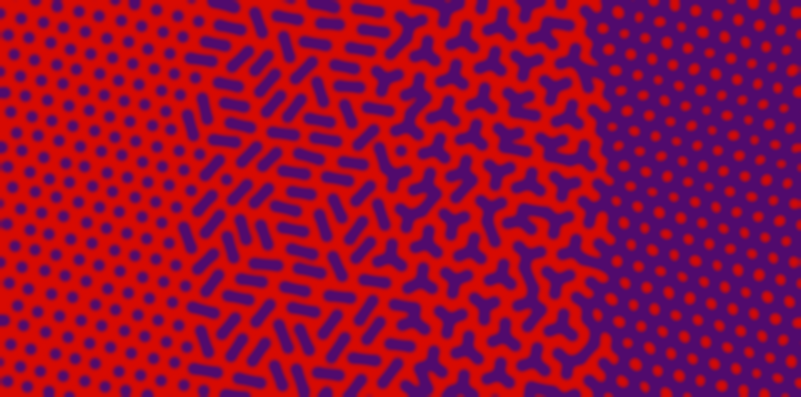
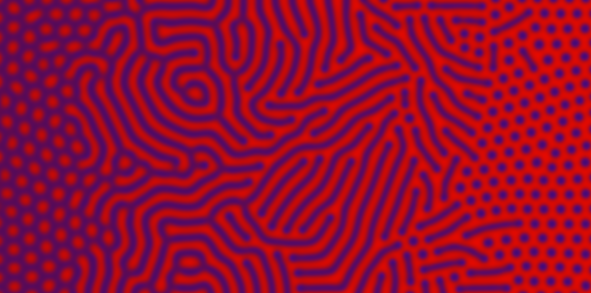

# Pit pattern シミュレーション — ゴール定義

**どのような結果が出れば成功か**を固定する文書。機構（反応拡散・座屈・Voronoi など）や数式はここでは決めない。新しいモデルは、まずこの文書に照らして合否を付ける。形態の参照は [`serrated_pitpattern.pptx`](serrated_pitpattern.pptx)、医学的背景は [`pit_pattern_literature.md`](pit_pattern_literature.md)。

---

## 1. ゴール

**固定した係数のまま 1 本の連続パラメータ \(p\) を動かすと、模様が**

```text
Type I  →  Type IIIL  →  Type IV_B  →  Type IV_V
```

**の順に変わる。変わるのはつながり方（点 → 短管 → Y → 網）だけで、pit の太さと間隔は変わらない。**

- 「Type らしい絵を別々の設定で描く」ことではない。スライド 6 の「I → IIIL → IV_B → IV_V の変化は連続的に表現できる」が本質。
- **独立初期化での再現性が必須**。共通の規則で作った複数のランダム初期条件から、同じ \(p\) 区間で同じ形態が出ること（画素配置の一致は求めない）。前の形態を引き継ぐ continuation や空間勾配の 1 枚だけでは合格にしない。固定の不均一場を使う場合は、その seed を初期条件と独立に変え、不均一性なしの対照も置く。手順は [独立初期化 protocol](pit_independent_initialization_protocol.md)。

## 2. 答案見本



*左から I → IIIL → IV_B → IV_V。紫 = pit・溝、赤 = 粘膜。プログラムによる描画で、シミュレーション結果ではない（[`src/make_pit_ideal_sweep.py`](../src/make_pit_ideal_sweep.py)）。点の間隔 27.5 px、紫の太さ 12–14 px、色はスライド 6 の実測値。*

| 帯 | 目標像 |
|---|---|
| **I** | 赤地に紫の丸い点が、三角格子状に規則的に並ぶ |
| **IIIL** | 帯の中の点は**ほぼすべて**、隣の点 1 つとだけつながった**まっすぐな短管**（長さは点の約 3 倍）。管どうしは離れている |
| **IV_B** | 帯の中の点は**ほぼすべて**、3 点が 1 か所でつながった **Y 字**か、Y が 2 つ程度つながった小さな樹。輪を作らない |
| **IV_V** | Y どうしが閉じて紫の網になり、**赤い点（粘膜）が I と同じ間隔・ほぼ同じ径で残る** ＝ **I の明暗反転** |

- **各帯はその形態だけで模様を作る**。IIIL・IV_B の帯に I の点が多く混ざるのは不合格。隣の形態が混ざってよいのは帯の境界（移行領域）だけ。
- **単位は伸び続けない**。IIIL の短管と IV_B の Y・樹は、\(p\) を進めても時間がたっても有限の大きさで止まる。

### 参照: スライド 6 の反応拡散スイープ



*`serrated_pitpattern.pptx` スライド 6。**右端**が赤地に紫の点（I）、**左端**が紫地に赤い点（I の明暗反転 ＝ IV_V）。太さ・間隔・並び方・質感は理想的。ただし中ほどでは紫の管が伸び続けて長いストライプ・迷路になっており、そこだけが目標と違う。上下比較は [`pit_ideal_sweep_compare.png`](images/pit_ideal_sweep_compare.png)。*

## 3. 判定基準

### 3.1 必須（Must）

- [ ] \(p\) の連続変化で **I → IIIL → IV_B → IV_V** の順に移る（逆行しない、IV_B を飛ばさない）
- [ ] **帯の純度**: IIIL の帯はほぼ短管だけ、IV_B の帯はほぼ Y 字と小さな樹だけ
- [ ] **単位の有限性**: 短管・Y・樹が伸び続けず、視野を横断する長い溝や平行ストライプにならない
- [ ] **IV_V は I の明暗反転**: 一定幅の網に、粘膜の点が規則的に残る
- [ ] **幅**: 各段階で `feature_width_median / w₀ ≤ 1.5`、IV_B・IV_V では加えて `feature_width_p90 / w₀ ≤ 2.0`
- [ ] 十分長い時間のあとも上記が保たれる（一瞬のスナップショットではない）
- [ ] 独立初期化で共通の \(p\) 区間に再現する（§1、protocol）

### 3.2 定量の目安（暫定）

\(w_0\) = Type I 領域の `feature_width_median`。指標の実装は [`src/pit_goal_metrics.py`](../src/pit_goal_metrics.py)、三叉の数え方は [`src/pit_fork_metrics.py`](../src/pit_fork_metrics.py)（既存の 8 近傍次数による検出は斜めの管の骨格の階段を誤認するため）。

| 指標 | I | IIIL | IV_B | IV_V |
|---|---|---|---|---|
| 幅 median / w₀ | ≈ 1.0 | ≤ 1.5 | ≤ 1.5 | ≤ 1.5 |
| 幅 p90 / w₀ | ≈ 1.0–1.3 | ≤ 1.8 | ≤ 2.0 | ≤ 2.0 |
| 単位の形 | 丸（伸長比 ≲ 2） | 短管（伸長比 ≲ 3） | Y・小さな樹（三叉が多くの単位に分散） | 網（粘膜が島） |
| 最長成分比 | 低 | 低 | 低〜中（≲ 0.4） | 高 |
| 帯の中の I の点 | — | ほぼ 0 | ほぼ 0 | — |

数値は画像とセットで読む。数値が合っていても、絵が幅暴走・平行ストライプ・伸び続ける溝なら不合格。

### 3.3 反例

| 反例 | 何が起きているか |
|---|---|
| 平行ストライプ（[`anti_goal_parallel_stripes.png`](images/anti_goal_parallel_stripes.png)） | 分岐も反転もない偽 IV |
| 分岐のない断片（[`anti_goal_dashes.png`](images/anti_goal_dashes.png)） | 線を切って Y まで消した偽 IV_B |
| 幅の暴走（[`anti_goal_thick.png`](images/anti_goal_thick.png)） | 太い塊・塗りつぶしを IV と呼んでいる |
| 管が伸び続けて長い溝・迷路になる | スライド 6 中ほどの状態。単位の有限性を満たさない |
| IIIL・IV_B の帯に I の点が多く残る | 帯の純度を満たさない |
| 設定ごとに別の式・別の初期条件 | 連続パラメータ変化ではない |

### 3.4 今は対象外

Type II / II-L / II-O、III_H、IV_H（シダの葉・松毬様）、Type VI / VN の再現、臨床診断精度・病理対応、特定の方程式への固定。

## 4. 参照ファイル

**規範（ゴールを定義するもの）**

| ファイル | 内容 |
|---|---|
| [`images/pit_ideal_sweep.png`](images/pit_ideal_sweep.png) | 答案見本（まずこれと見比べる）。比較図 [`pit_ideal_sweep_compare.png`](images/pit_ideal_sweep_compare.png) |
| [`images/goal_rd_sweep_i_to_iv.png`](images/goal_rd_sweep_i_to_iv.png) | スライド 6。右端 = I、左端 = IV_V。中ほどの伸び続けるストライプは目標外 |
| [`images/pit_reference_sheet.png`](images/pit_reference_sheet.png) | 手元の実画像（工藤分類表・鋸歯状病変）の参照シート |
| [`images/anti_goal_*.png`](images/) | 反例（§3.3） |
| [`serrated_pitpattern.pptx`](serrated_pitpattern.pptx) | 鋸歯状 pit の整理スライド |

旧版の見本 [`goal_target_sweep.png`](images/goal_target_sweep.png) と [`goal_schematic_i_iiil_ivb_ivv.png`](images/goal_schematic_i_iiil_ivb_ivv.png) は、IV_V を迷路として描いているため規範から外した（2026-10-10）。

**実績（シミュレーション結果。規範ではない）**

| ファイル | 内容 |
|---|---|
| [`pit_groove_model.md`](pit_groove_model.md) | 畝–溝モデル（2026-10-10）の結果と限界 |
| [`images/pit_model_comparison.png`](images/pit_model_comparison.png) | これまでの候補モデル 9 種の比較 |
| [`images/goal_all_results_one_page.png`](images/goal_all_results_one_page.png) | 空間勾配モデルのサマリー（[`pit_progression_model.md`](pit_progression_model.md)） |

臨床写真・文献図を加えるときは出典を明記し、形態の参考であって診断の根拠ではないと添える。手段（飽和・座屈・fission など）がゴールを再定義しないこと。
